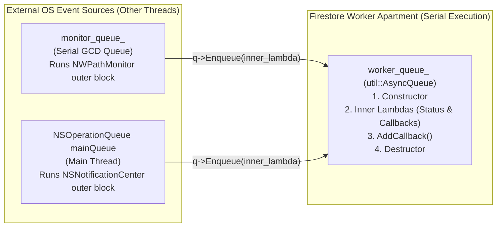

# Thread-Safety Analysis of `ConnectivityMonitorApple`

This report explains the concurrency model and thread-safety mechanics of [`ConnectivityMonitorApple`](file:///Users/dconeybe/work/ios/TsanDataRaceFix/Firestore/core/src/remote/connectivity_monitor_apple.h#L71-L96) ([connectivity_monitor_apple.h](file:///Users/dconeybe/work/ios/TsanDataRaceFix/Firestore/core/src/remote/connectivity_monitor_apple.h) and [connectivity_monitor_apple.mm](file:///Users/dconeybe/work/ios/TsanDataRaceFix/Firestore/core/src/remote/connectivity_monitor_apple.mm)), alongside its base class [`ConnectivityMonitor`](file:///Users/dconeybe/work/ios/TsanDataRaceFix/Firestore/core/src/remote/connectivity_monitor.h#L36-L89) ([connectivity_monitor.h](file:///Users/dconeybe/work/ios/TsanDataRaceFix/Firestore/core/src/remote/connectivity_monitor.h) and [connectivity_monitor.cc](file:///Users/dconeybe/work/ios/TsanDataRaceFix/Firestore/core/src/remote/connectivity_monitor.cc)) and execution engine [`util::AsyncQueue`](file:///Users/dconeybe/work/ios/TsanDataRaceFix/Firestore/core/src/util/async_queue.h#L94-L250) ([async_queue.h](file:///Users/dconeybe/work/ios/TsanDataRaceFix/Firestore/core/src/util/async_queue.h)).

---

## 1. Executive Summary: The Concurrency Model

Rather than protecting mutable state with mutexes, [`ConnectivityMonitorApple`](file:///Users/dconeybe/work/ios/TsanDataRaceFix/Firestore/core/src/remote/connectivity_monitor_apple.h#L71-L96) uses a **Single-Threaded Apartment / Actor confinement model** combined with an **atomic reference-counted liveness token** ([`state_`](file:///Users/dconeybe/work/ios/TsanDataRaceFix/Firestore/core/src/remote/connectivity_monitor_apple.h#L92)):

1. **Confinement to a Serial Queue (`worker_queue_`)**: All reads and writes to the object's state—including construction, destruction, callback registration, and network status updates—are confined to a single serial executor, [`util::AsyncQueue`](file:///Users/dconeybe/work/ios/TsanDataRaceFix/Firestore/core/src/util/async_queue.h#L94-L250). Because tasks on a serial queue never overlap in time, no mutex is needed to protect member variables.
2. **Two-Hop Asynchronous Event Bridging**: OS-level connectivity and lifecycle notifications arrive on external threads (a dedicated Grand Central Dispatch serial queue [`monitor_queue_`](file:///Users/dconeybe/work/ios/TsanDataRaceFix/Firestore/core/src/remote/connectivity_monitor_apple.h#L91) and the iOS main thread). The callbacks running on those external threads ("outer blocks") do **not** read or write any member variables of `this`. Instead, they extract the event value and enqueue a C++ closure ("inner lambda") onto [`worker_queue_`](file:///Users/dconeybe/work/ios/TsanDataRaceFix/Firestore/core/src/remote/connectivity_monitor.h#L86).
3. **Lifetime Decoupling via [`state_`](file:///Users/dconeybe/work/ios/TsanDataRaceFix/Firestore/core/src/remote/connectivity_monitor_apple.h#L92)**: Because [`ConnectivityMonitorApple`](file:///Users/dconeybe/work/ios/TsanDataRaceFix/Firestore/core/src/remote/connectivity_monitor_apple.h#L71-L96) is owned by a `std::unique_ptr<ConnectivityMonitor>` (inside [`FirestoreClient`](file:///Users/dconeybe/work/ios/TsanDataRaceFix/Firestore/core/src/core/firestore_client.cc#L247)), the object itself cannot be kept alive by `std::shared_ptr`. Instead, [`state_`](file:///Users/dconeybe/work/ios/TsanDataRaceFix/Firestore/core/src/remote/connectivity_monitor_apple.h#L92) (`std::shared_ptr<State>`) is an empty struct whose heap-allocated **reference-count control block** acts as a thread-safe tombstone. When [`~ConnectivityMonitorApple()`](file:///Users/dconeybe/work/ios/TsanDataRaceFix/Firestore/core/src/remote/connectivity_monitor_apple.mm#L136-L166) runs on [`worker_queue_`](file:///Users/dconeybe/work/ios/TsanDataRaceFix/Firestore/core/src/remote/connectivity_monitor.h#L86) and calls [`state_.reset()`](file:///Users/dconeybe/work/ios/TsanDataRaceFix/Firestore/core/src/remote/connectivity_monitor_apple.mm#L154), any already-enqueued inner lambdas that subsequently run on [`worker_queue_`](file:///Users/dconeybe/work/ios/TsanDataRaceFix/Firestore/core/src/remote/connectivity_monitor.h#L86) see an expired `std::weak_ptr<State>` and abort before dereferencing the dangling `raw_this` pointer.

---

## 2. Execution Contexts (Threads & Queues) and State Confinement

Three distinct execution contexts interact during the lifetime of [`ConnectivityMonitorApple`](file:///Users/dconeybe/work/ios/TsanDataRaceFix/Firestore/core/src/remote/connectivity_monitor_apple.h#L71-L96):



### Execution Context Summary

| Execution Context | Underlying Thread(s) | Code Executed Here | Member Variables Accessed |
| :--- | :--- | :--- | :--- |
| **[`worker_queue_`](file:///Users/dconeybe/work/ios/TsanDataRaceFix/Firestore/core/src/remote/connectivity_monitor.h#L86)** ([`util::AsyncQueue`](file:///Users/dconeybe/work/ios/TsanDataRaceFix/Firestore/core/src/util/async_queue.h#L94-L250)) | Single serial executor (FIFO, non-overlapping tasks) | [`ConnectivityMonitorApple()`](file:///Users/dconeybe/work/ios/TsanDataRaceFix/Firestore/core/src/remote/connectivity_monitor_apple.mm#L56-L134), [`~ConnectivityMonitorApple()`](file:///Users/dconeybe/work/ios/TsanDataRaceFix/Firestore/core/src/remote/connectivity_monitor_apple.mm#L136-L166), [`AddCallback()`](file:///Users/dconeybe/work/ios/TsanDataRaceFix/Firestore/core/src/remote/connectivity_monitor.h#L62-L64), [`GetCurrentStatusForTesting()`](file:///Users/dconeybe/work/ios/TsanDataRaceFix/Firestore/core/src/remote/connectivity_monitor_apple.h#L78-L80), and both inner lambdas ([lines 92–101](file:///Users/dconeybe/work/ios/TsanDataRaceFix/Firestore/core/src/remote/connectivity_monitor_apple.mm#L92-L101), [lines 121–131](file:///Users/dconeybe/work/ios/TsanDataRaceFix/Firestore/core/src/remote/connectivity_monitor_apple.mm#L121-L131)) | **All** base and derived members: [`status_`](file:///Users/dconeybe/work/ios/TsanDataRaceFix/Firestore/core/src/remote/connectivity_monitor.h#L88), [`callbacks_`](file:///Users/dconeybe/work/ios/TsanDataRaceFix/Firestore/core/src/remote/connectivity_monitor.h#L87), [`worker_queue_`](file:///Users/dconeybe/work/ios/TsanDataRaceFix/Firestore/core/src/remote/connectivity_monitor.h#L86), [`monitor_`](file:///Users/dconeybe/work/ios/TsanDataRaceFix/Firestore/core/src/remote/connectivity_monitor_apple.h#L90), [`monitor_queue_`](file:///Users/dconeybe/work/ios/TsanDataRaceFix/Firestore/core/src/remote/connectivity_monitor_apple.h#L91), [`state_`](file:///Users/dconeybe/work/ios/TsanDataRaceFix/Firestore/core/src/remote/connectivity_monitor_apple.h#L92), [`observer_`](file:///Users/dconeybe/work/ios/TsanDataRaceFix/Firestore/core/src/remote/connectivity_monitor_apple.h#L94) |
| **[`monitor_queue_`](file:///Users/dconeybe/work/ios/TsanDataRaceFix/Firestore/core/src/remote/connectivity_monitor_apple.h#L91)** (`dispatch_queue_t`) | GCD utility thread pool (serialized per queue) | Outer Objective-C block passed to [`nw_path_monitor_set_update_handler`](file:///Users/dconeybe/work/ios/TsanDataRaceFix/Firestore/core/src/remote/connectivity_monitor_apple.mm#L83-L102); empty block in [`dispatch_sync`](file:///Users/dconeybe/work/ios/TsanDataRaceFix/Firestore/core/src/remote/connectivity_monitor_apple.mm#L160-L161) | **None.** Only reads block-captured copies of `weak_state`, `weak_queue`, and the raw pointer value `this` (without dereferencing `this`). |
| **`[NSOperationQueue mainQueue]`** | Process main / UI thread (serial) | Outer Objective-C block passed to [`addObserverForName:...`](file:///Users/dconeybe/work/ios/TsanDataRaceFix/Firestore/core/src/remote/connectivity_monitor_apple.mm#L107-L132) | **None.** Only reads block-captured copies of `weak_state`, `weak_queue`, and the raw pointer value `this` (without dereferencing `this`). |

### How Base-Class State ([`ConnectivityMonitor`](file:///Users/dconeybe/work/ios/TsanDataRaceFix/Firestore/core/src/remote/connectivity_monitor.h#L36-L89)) Is Protected

In [`ConnectivityMonitor`](file:///Users/dconeybe/work/ios/TsanDataRaceFix/Firestore/core/src/remote/connectivity_monitor.h#L85-L89), the data members have no internal synchronization:

* [`status_`](file:///Users/dconeybe/work/ios/TsanDataRaceFix/Firestore/core/src/remote/connectivity_monitor.h#L88) (`absl::optional<NetworkStatus>`) is read and mutated by [`SetInitialStatus`](file:///Users/dconeybe/work/ios/TsanDataRaceFix/Firestore/core/src/remote/connectivity_monitor.cc#L26-L30), [`MaybeInvokeCallbacks`](file:///Users/dconeybe/work/ios/TsanDataRaceFix/Firestore/core/src/remote/connectivity_monitor.cc#L32-L38), [`InvokeCallbacks`](file:///Users/dconeybe/work/ios/TsanDataRaceFix/Firestore/core/src/remote/connectivity_monitor.cc#L40-L45), and [`current_status`](file:///Users/dconeybe/work/ios/TsanDataRaceFix/Firestore/core/src/remote/connectivity_monitor.h#L71-L73).
* [`callbacks_`](file:///Users/dconeybe/work/ios/TsanDataRaceFix/Firestore/core/src/remote/connectivity_monitor.h#L87) (`std::vector<Callback>`) is mutated by [`AddCallback`](file:///Users/dconeybe/work/ios/TsanDataRaceFix/Firestore/core/src/remote/connectivity_monitor.h#L62-L64) and iterated by [`InvokeCallbacks`](file:///Users/dconeybe/work/ios/TsanDataRaceFix/Firestore/core/src/remote/connectivity_monitor.cc#L40-L45).

Notice that [`AddCallback`](file:///Users/dconeybe/work/ios/TsanDataRaceFix/Firestore/core/src/remote/connectivity_monitor.h#L62-L64) does **not** assert `worker_queue_->IsCurrentQueue()`. Its thread safety depends on callers (such as [`RemoteStore::Start()`](file:///Users/dconeybe/work/ios/TsanDataRaceFix/Firestore/core/src/remote/remote_store.cc#L84-L99) and [`GrpcConnection::RegisterConnectivityMonitor()`](file:///Users/dconeybe/work/ios/TsanDataRaceFix/Firestore/core/src/remote/grpc_connection.cc#L389-L405)) invoking [`AddCallback`](file:///Users/dconeybe/work/ios/TsanDataRaceFix/Firestore/core/src/remote/connectivity_monitor.h#L62-L64) exclusively from tasks running on [`worker_queue_`](file:///Users/dconeybe/work/ios/TsanDataRaceFix/Firestore/core/src/remote/connectivity_monitor.h#L86). Similarly, [`ConnectivityMonitor`](file:///Users/dconeybe/work/ios/TsanDataRaceFix/Firestore/core/src/remote/connectivity_monitor.h#L65) has no `RemoveCallback` method; callers like [`RemoteStore`](file:///Users/dconeybe/work/ios/TsanDataRaceFix/Firestore/core/src/remote/remote_store.cc#L85) and [`GrpcConnection`](file:///Users/dconeybe/work/ios/TsanDataRaceFix/Firestore/core/src/remote/grpc_connection.cc#L391) register callbacks capturing raw `[this]`. During shutdown in [`FirestoreClient::TerminateInternal()`](file:///Users/dconeybe/work/ios/TsanDataRaceFix/Firestore/core/src/core/firestore_client.cc#L322-L353), [`remote_store_.reset()`](file:///Users/dconeybe/work/ios/TsanDataRaceFix/Firestore/core/src/core/firestore_client.cc#L344) and [`connectivity_monitor_.reset()`](file:///Users/dconeybe/work/ios/TsanDataRaceFix/Firestore/core/src/core/firestore_client.cc#L352) execute inside the **same** synchronous task on [`worker_queue_`](file:///Users/dconeybe/work/ios/TsanDataRaceFix/Firestore/core/src/remote/connectivity_monitor.h#L86), preventing any queued connectivity update from firing between `RemoteStore` destruction and `ConnectivityMonitor` destruction.

---

## 3. Deep Dive: How [`state_`](file:///Users/dconeybe/work/ios/TsanDataRaceFix/Firestore/core/src/remote/connectivity_monitor_apple.h#L92) Contributes to Thread Safety

### The Fundamental Problem [`state_`](file:///Users/dconeybe/work/ios/TsanDataRaceFix/Firestore/core/src/remote/connectivity_monitor_apple.h#L92) Solves

When an external OS thread ([`monitor_queue_`](file:///Users/dconeybe/work/ios/TsanDataRaceFix/Firestore/core/src/remote/connectivity_monitor_apple.h#L91) or `mainQueue`) receives a connectivity event, it calls [`q->Enqueue(...)`](file:///Users/dconeybe/work/ios/TsanDataRaceFix/Firestore/core/src/remote/connectivity_monitor_apple.mm#L92) to schedule an inner lambda on [`worker_queue_`](file:///Users/dconeybe/work/ios/TsanDataRaceFix/Firestore/core/src/remote/connectivity_monitor.h#L86). That inner lambda needs to call methods on the [`ConnectivityMonitorApple`](file:///Users/dconeybe/work/ios/TsanDataRaceFix/Firestore/core/src/remote/connectivity_monitor_apple.h#L71-L96) instance (`raw_this`).

However, [`ConnectivityMonitorApple`](file:///Users/dconeybe/work/ios/TsanDataRaceFix/Firestore/core/src/remote/connectivity_monitor_apple.h#L71-L96) is owned by a `std::unique_ptr<ConnectivityMonitor>`, not a `std::shared_ptr`. Between the moment the external thread enqueues the inner lambda onto [`worker_queue_`](file:///Users/dconeybe/work/ios/TsanDataRaceFix/Firestore/core/src/remote/connectivity_monitor.h#L86) and the moment [`worker_queue_`](file:///Users/dconeybe/work/ios/TsanDataRaceFix/Firestore/core/src/remote/connectivity_monitor.h#L86) actually executes that inner lambda, an earlier task on [`worker_queue_`](file:///Users/dconeybe/work/ios/TsanDataRaceFix/Firestore/core/src/remote/connectivity_monitor.h#L86) may destroy the [`ConnectivityMonitorApple`](file:///Users/dconeybe/work/ios/TsanDataRaceFix/Firestore/core/src/remote/connectivity_monitor_apple.h#L71-L96) instance, leaving `raw_this` as a dangling pointer.

### How [`state_`](file:///Users/dconeybe/work/ios/TsanDataRaceFix/Firestore/core/src/remote/connectivity_monitor_apple.h#L92) Works as a Detached Tombstone

[`ConnectivityMonitorApple`](file:///Users/dconeybe/work/ios/TsanDataRaceFix/Firestore/core/src/remote/connectivity_monitor_apple.h#L88-L92) defines an empty struct and a `std::shared_ptr` to it:

```cpp
struct State {};
std::shared_ptr<State> state_;
```

 Even though `struct State {}` contains no fields, `std::make_shared<State>()` allocates a **reference-counting control block** on the heap containing two atomic counters:
* **Strong count** (`shared_owners`): number of live `std::shared_ptr<State>` instances.
* **Weak count** (`shared_weak_owners`): number of live `std::weak_ptr<State>` instances.

The control block itself stays allocated on the heap until **both** the strong count and the weak count reach zero. Thus, even after `ConnectivityMonitorApple` is freed (`delete this`), any `std::weak_ptr<State>` captured inside an enqueued lambda still points to a valid heap control block and can safely query whether the strong count is zero.

> [!IMPORTANT]
> **The Three Load-Bearing Invariants of `state_`**
>
> The combination of `raw_this` and `weak_state` prevents use-after-free **if and only if** all three of the following invariants hold simultaneously:
> 1. **Destruction and inner lambdas run on the same serial queue (`worker_queue_`)**: Enforced by [`HARD_ASSERT(this->queue()->IsCurrentQueue(), ...)`](file:///Users/dconeybe/work/ios/TsanDataRaceFix/Firestore/core/src/remote/connectivity_monitor_apple.mm#L137-L139) in the destructor. Because [`worker_queue_`](file:///Users/dconeybe/work/ios/TsanDataRaceFix/Firestore/core/src/remote/connectivity_monitor.h#L86) is serial, [`~ConnectivityMonitorApple()`](file:///Users/dconeybe/work/ios/TsanDataRaceFix/Firestore/core/src/remote/connectivity_monitor_apple.mm#L136-L166) and an inner lambda can never execute at the same time.
> 2. **Construction runs on `worker_queue_`**: Enforced by [`HARD_ASSERT(this->queue()->IsCurrentQueue(), ...)`](file:///Users/dconeybe/work/ios/TsanDataRaceFix/Firestore/core/src/remote/connectivity_monitor_apple.mm#L59-L61) in the constructor. Because the constructor starts [`monitor_`](file:///Users/dconeybe/work/ios/TsanDataRaceFix/Firestore/core/src/remote/connectivity_monitor_apple.mm#L104) and registers [`observer_`](file:///Users/dconeybe/work/ios/TsanDataRaceFix/Firestore/core/src/remote/connectivity_monitor_apple.mm#L107) before the constructor returns, an external thread can immediately enqueue an inner lambda while the constructor is still executing. Running the constructor on [`worker_queue_`](file:///Users/dconeybe/work/ios/TsanDataRaceFix/Firestore/core/src/remote/connectivity_monitor.h#L86) guarantees that the constructor task finishes before any enqueued inner lambda can start.
> 3. **Exclusive Strong Ownership on `worker_queue_`**: Outside of [`worker_queue_`](file:///Users/dconeybe/work/ios/TsanDataRaceFix/Firestore/core/src/remote/connectivity_monitor.h#L86), **no thread ever holds a `std::shared_ptr<State>`** (outer blocks never call `weak_state.lock()`). Consequently, when [`~ConnectivityMonitorApple()`](file:///Users/dconeybe/work/ios/TsanDataRaceFix/Firestore/core/src/remote/connectivity_monitor_apple.mm#L136-L166) runs on [`worker_queue_`](file:///Users/dconeybe/work/ios/TsanDataRaceFix/Firestore/core/src/remote/connectivity_monitor.h#L86), [`this->state_`](file:///Users/dconeybe/work/ios/TsanDataRaceFix/Firestore/core/src/remote/connectivity_monitor_apple.h#L92) is guaranteed to be the **only** `std::shared_ptr<State>` in existence (strong count == 1). Calling [`state_.reset()`](file:///Users/dconeybe/work/ios/TsanDataRaceFix/Firestore/core/src/remote/connectivity_monitor_apple.mm#L154) is therefore guaranteed to drop the strong count to `0` immediately and permanently.

### Why Mutual Exclusion on `worker_queue_` Makes `raw_this` Safe

Because every inner lambda and the destructor both execute as tasks on the serial [`worker_queue_`](file:///Users/dconeybe/work/ios/TsanDataRaceFix/Firestore/core/src/remote/connectivity_monitor.h#L86), any inner lambda is totally ordered either **before** or **after** [`~ConnectivityMonitorApple()`](file:///Users/dconeybe/work/ios/TsanDataRaceFix/Firestore/core/src/remote/connectivity_monitor_apple.mm#L136-L166):

```mermaid
sequenceDiagram
    participant Ext as "External Queue (monitor_queue_ or mainQueue)"
    participant WQ as "worker_queue_ (Serial AsyncQueue)"
    participant Ctrl as "State Control Block (Heap)"

    Note over WQ,Ctrl: Constructor runs on worker_queue_ (strong_count = 1)
    Ext->>Ext: OS event fires outer block
    Ext->>WQ: q->Enqueue(inner_lambda_1)
    Ext->>WQ: q->Enqueue(inner_lambda_2)

    rect rgb(230, 245, 230)
    Note over WQ,Ctrl: Case 1: inner_lambda_1 runs BEFORE destructor
    WQ->>Ctrl: weak_state.lock() (strong_count: 1 -> 2)
    WQ->>WQ: Mutates raw_this->status_ & invokes callbacks_
    WQ->>Ctrl: s2 destroyed at lambda exit (strong_count: 2 -> 1)
    end

    rect rgb(245, 235, 230)
    Note over WQ,Ctrl: Destructor Task runs on worker_queue_
    WQ->>WQ: ~ConnectivityMonitorApple() starts
    WQ->>Ctrl: state_.reset() (strong_count: 1 -> 0)
    WQ->>WQ: ~ConnectivityMonitorApple() finishes; memory of *this freed
    end

    rect rgb(230, 240, 250)
    Note over WQ,Ctrl: Case 2: inner_lambda_2 runs AFTER destructor
    WQ->>Ctrl: weak_state.lock() observes strong_count == 0 -> returns nullptr
    WQ->>WQ: if (!s2) return; (raw_this is NEVER dereferenced)
    WQ->>Ctrl: inner_lambda_2 destroyed (weak_count decremented)
    end
```

---

## 4. Counterexamples: What Breaks If Any Invariant Is Violated

To see why each piece of the design exists, consider what happens if any of the three invariants is removed.

### Counterexample A: What if `state_` did not exist (relying only on `nw_path_monitor_cancel` and `removeObserver:`)?

Suppose the inner lambda simply captured `raw_this = this` without `weak_state`. Even though the destructor calls [`removeObserver:`](file:///Users/dconeybe/work/ios/TsanDataRaceFix/Firestore/core/src/remote/connectivity_monitor_apple.mm#L143), [`nw_path_monitor_cancel()`](file:///Users/dconeybe/work/ios/TsanDataRaceFix/Firestore/core/src/remote/connectivity_monitor_apple.mm#L151), and [`dispatch_sync(monitor_queue_, ^{})`](file:///Users/dconeybe/work/ios/TsanDataRaceFix/Firestore/core/src/remote/connectivity_monitor_apple.mm#L160), an inner lambda could **already** have been enqueued into [`worker_queue_`](file:///Users/dconeybe/work/ios/TsanDataRaceFix/Firestore/core/src/remote/connectivity_monitor.h#L86)'s FIFO buffer before the destructor task started:

```mermaid
sequenceDiagram
    participant MQ as "monitor_queue_"
    participant WQ as "worker_queue_ (FIFO)"

    Note over WQ: Task A: FirestoreClient::TerminateInternal() is currently running
    MQ->>WQ: Outer handler runs and calls q->Enqueue(inner_lambda)
    Note over WQ: FIFO Queue now has: [Task A (running), inner_lambda (queued)]
    WQ->>WQ: Task A calls connectivity_monitor_.reset() -> ~ConnectivityMonitorApple()
    WQ->>MQ: nw_path_monitor_cancel() + dispatch_sync(monitor_queue_)
    WQ->>WQ: ConnectivityMonitorApple memory is freed (delete this)
    WQ->>WQ: Task A finishes; worker_queue_ pops next task: inner_lambda
    WQ->>WQ: inner_lambda dereferences raw_this -> USE-AFTER-FREE!
```

Canceling the monitor or draining `monitor_queue_` only stops *future* outer blocks; it cannot un-enqueue an inner lambda that is already sitting in [`worker_queue_`](file:///Users/dconeybe/work/ios/TsanDataRaceFix/Firestore/core/src/remote/connectivity_monitor.h#L86).

### Counterexample B: What if the outer block called `weak_state.lock()` instead of `weak_state.expired()`?

A common question when reading [line 88](file:///Users/dconeybe/work/ios/TsanDataRaceFix/Firestore/core/src/remote/connectivity_monitor_apple.mm#L88) and [line 117](file:///Users/dconeybe/work/ios/TsanDataRaceFix/Firestore/core/src/remote/connectivity_monitor_apple.mm#L117) is: *Why does the outer block call `if (weak_state.expired()) return;` instead of `auto s = weak_state.lock(); if (!s) return;`?*

Because `State` is just an empty token (not the `ConnectivityMonitorApple` object itself), holding a `std::shared_ptr<State>` in an outer block keeps `State` alive **without** keeping `ConnectivityMonitorApple` alive! Look at what happens on the main queue (which is **not** drained by the destructor) if the outer block calls `auto s = weak_state.lock()`:

```mermaid
sequenceDiagram
    participant MainQ as "mainQueue (Main Thread)"
    participant WQ as "worker_queue_ (Worker Thread)"
    participant Ctrl as "State Control Block"

    MainQ->>Ctrl: Outer block calls s = weak_state.lock() (strong_count: 1 -> 2)
    MainQ->>WQ: Outer block calls q->Enqueue(inner_lambda)
    Note over MainQ: Main thread is preempted by OS scheduler before `s` goes out of scope!
    WQ->>WQ: ~ConnectivityMonitorApple() runs on worker_queue_
    WQ->>Ctrl: Calls state_.reset() (strong_count drops 2 -> 1, NOT 0!)
    WQ->>WQ: ~ConnectivityMonitorApple() finishes; delete this frees ConnectivityMonitorApple!
    WQ->>WQ: worker_queue_ runs inner_lambda
    WQ->>Ctrl: inner_lambda calls s2 = weak_state.lock() (strong_count: 1 -> 2, SUCCEEDS!)
    WQ->>WQ: inner_lambda dereferences raw_this -> USE-AFTER-FREE!
```

By never calling `weak_state.lock()` outside [`worker_queue_`](file:///Users/dconeybe/work/ios/TsanDataRaceFix/Firestore/core/src/remote/connectivity_monitor.h#L86), the strong reference count is guaranteed to be `1` when [`~ConnectivityMonitorApple()`](file:///Users/dconeybe/work/ios/TsanDataRaceFix/Firestore/core/src/remote/connectivity_monitor_apple.mm#L136-L166) calls [`state_.reset()`](file:///Users/dconeybe/work/ios/TsanDataRaceFix/Firestore/core/src/remote/connectivity_monitor_apple.mm#L154), so `state_.reset()` is guaranteed to drop the strong count to `0`.

### Counterexample C: What if [`~ConnectivityMonitorApple()`](file:///Users/dconeybe/work/ios/TsanDataRaceFix/Firestore/core/src/remote/connectivity_monitor_apple.mm#L136-L166) ran on a thread other than `worker_queue_`?

Because `std::shared_ptr<State>` only tracks the lifetime of `State` (not `ConnectivityMonitorApple`), destroying `ConnectivityMonitorApple` on another thread would race directly with an inner lambda already executing on [`worker_queue_`](file:///Users/dconeybe/work/ios/TsanDataRaceFix/Firestore/core/src/remote/connectivity_monitor.h#L86):

1. `worker_queue_` starts running the inner lambda and calls `auto s2 = weak_state.lock()`. `s2` succeeds (strong count = 2).
2. Concurrently on another thread, `~ConnectivityMonitorApple()` runs to completion (ignoring `s2`, because `~ConnectivityMonitorApple()` does not wait for `s2` to be released) and `delete this` frees `ConnectivityMonitorApple`.
3. On `worker_queue_`, line 96 (`raw_this->current_status()`) executes concurrently with or after `~ConnectivityMonitorApple()`, causing a data race and use-after-free.

### Counterexample D: What if [`ConnectivityMonitorApple()`](file:///Users/dconeybe/work/ios/TsanDataRaceFix/Firestore/core/src/remote/connectivity_monitor_apple.mm#L56-L134) was constructed on a thread other than `worker_queue_`?

In the constructor, [`nw_path_monitor_start(monitor_)`](file:///Users/dconeybe/work/ios/TsanDataRaceFix/Firestore/core/src/remote/connectivity_monitor_apple.mm#L104) is called at line 104, before [`this->observer_ = ...`](file:///Users/dconeybe/work/ios/TsanDataRaceFix/Firestore/core/src/remote/connectivity_monitor_apple.mm#L107) at line 107 and before the constructor returns (and before a caller on that thread might call `AddCallback`).

If the constructor ran on Thread X (not [`worker_queue_`](file:///Users/dconeybe/work/ios/TsanDataRaceFix/Firestore/core/src/remote/connectivity_monitor.h#L86)):
1. At line 104, `nw_path_monitor_start` triggers the initial path update on `monitor_queue_`, which immediately enqueues an inner lambda onto `worker_queue_`.
2. Because `worker_queue_` is idle, `worker_queue_` immediately starts executing that inner lambda (`raw_this->SetInitialStatus(status)`) while Thread X is still inside the `ConnectivityMonitorApple` constructor (or immediately thereafter calling `monitor->AddCallback(...)` on Thread X), causing a data race on [`status_`](file:///Users/dconeybe/work/ios/TsanDataRaceFix/Firestore/core/src/remote/connectivity_monitor.h#L88), [`callbacks_`](file:///Users/dconeybe/work/ios/TsanDataRaceFix/Firestore/core/src/remote/connectivity_monitor.h#L87), and the object's vtable/members.

When the constructor runs **on** [`worker_queue_`](file:///Users/dconeybe/work/ios/TsanDataRaceFix/Firestore/core/src/remote/connectivity_monitor.h#L86), [`worker_queue_`](file:///Users/dconeybe/work/ios/TsanDataRaceFix/Firestore/core/src/remote/connectivity_monitor.h#L86) is busy executing the task that called the constructor (e.g., [`FirestoreClient::Initialize`](file:///Users/dconeybe/work/ios/TsanDataRaceFix/Firestore/core/src/core/firestore_client.cc#L247), which also registers callbacks in `RemoteStore` and `GrpcConnection`). Any inner lambda enqueued by `monitor_queue_` during construction sits safely in [`worker_queue_`](file:///Users/dconeybe/work/ios/TsanDataRaceFix/Firestore/core/src/remote/connectivity_monitor.h#L86)'s FIFO queue until the entire initialization task finishes.

---

## 5. Critical Audit: Load-Bearing vs. Redundant vs. Dead Code

Not every concurrency call in [connectivity_monitor_apple.mm](file:///Users/dconeybe/work/ios/TsanDataRaceFix/Firestore/core/src/remote/connectivity_monitor_apple.mm) is required for correctness. The table and analysis below separate the strictly load-bearing operations from optimizations, defense-in-depth measures, and dead code.

| Code Construct | Location | Classification | Why |
| :--- | :--- | :--- | :--- |
| `HARD_ASSERT(queue()->IsCurrentQueue())` | [Lines 59, 137](file:///Users/dconeybe/work/ios/TsanDataRaceFix/Firestore/core/src/remote/connectivity_monitor_apple.mm#L59) | **Load-Bearing** | Enforces single-queue confinement of construction and destruction with inner lambdas. |
| `state_{std::make_shared<State>()}` & `state_.reset()` | [Lines 58, 154](file:///Users/dconeybe/work/ios/TsanDataRaceFix/Firestore/core/src/remote/connectivity_monitor_apple.mm#L58) | **Load-Bearing** | Creates and invalidates the liveness token on `worker_queue_`. |
| `auto s2 = weak_state.lock(); if (!s2) return;` in inner lambdas | [Lines 93–94, 122–123](file:///Users/dconeybe/work/ios/TsanDataRaceFix/Firestore/core/src/remote/connectivity_monitor_apple.mm#L93-L94) | **Load-Bearing** | Prevents already-enqueued inner lambdas from dereferencing `raw_this` after destruction (`weak_state.expired()` would also work here since it runs on `worker_queue_`). |
| `auto q = weak_queue.lock(); if (!q) return;` in outer blocks | [Lines 89–90, 118–119](file:///Users/dconeybe/work/ios/TsanDataRaceFix/Firestore/core/src/remote/connectivity_monitor_apple.mm#L89-L90) | **Load-Bearing** | Prevents calling `Enqueue` on a destroyed `AsyncQueue` while avoiding a reference cycle (`AsyncQueue` -> queued tasks -> `ConnectivityMonitorApple` -> `AsyncQueue`). |
| `nw_path_monitor_cancel(monitor_)` & `removeObserver:` | [Lines 143, 151](file:///Users/dconeybe/work/ios/TsanDataRaceFix/Firestore/core/src/remote/connectivity_monitor_apple.mm#L143) | **Load-Bearing (Resource Cleanup)** | Stops the OS from firing future callbacks endlessly and releases the blocks (which capture `weak_state` and `weak_queue`) so the `State` control block can be freed. |
| `if (weak_state.expired()) return;` in outer blocks | [Lines 88, 117](file:///Users/dconeybe/work/ios/TsanDataRaceFix/Firestore/core/src/remote/connectivity_monitor_apple.mm#L88) | **Redundant Optimization** | Purely an optimistic fast-path check; subject to TOCTOU races and not needed for memory safety. |
| `dispatch_sync(monitor_queue_, ^{})` in destructor | [Lines 160–161](file:///Users/dconeybe/work/ios/TsanDataRaceFix/Firestore/core/src/remote/connectivity_monitor_apple.mm#L160-L161) | **Redundant Defense-in-Depth** | Drains in-flight outer blocks on `monitor_queue_`, which is unnecessary because outer blocks never dereference `this` and `mainQueue` is not drained anyway. |
| `kMonitorQueueKey` & `dispatch_queue_set_specific(...)` | [Lines 35, 75–76](file:///Users/dconeybe/work/ios/TsanDataRaceFix/Firestore/core/src/remote/connectivity_monitor_apple.mm#L35) | **Dead Code** | Sets a queue-specific context pointer on `monitor_queue_` that is never queried via `dispatch_get_specific`. |

### Detailed Critique of Non-Essential Constructs

#### 1. Why `if (weak_state.expired()) return;` in the outer blocks ([lines 88, 117](file:///Users/dconeybe/work/ios/TsanDataRaceFix/Firestore/core/src/remote/connectivity_monitor_apple.mm#L88)) is only an optimization
In the outer blocks on `monitor_queue_` and `mainQueue`:
```cpp
if (weak_state.expired()) return;
auto q = weak_queue.lock();
if (!q) return;
auto status = ToNetworkStatus(path);
q->Enqueue([raw_this = this, weak_state, status]() { ... });
```
* **It has a Time-of-Check to Time-of-Use (TOCTOU) window**: `weak_state.expired()` can return `false` on `monitor_queue_`, and one nanosecond later on `worker_queue_`, `~ConnectivityMonitorApple()` can call `state_.reset()` and destroy `this` before `q->Enqueue(...)` even finishes.
* **Why that TOCTOU window is harmless**: Nothing in the outer block after `weak_state.expired()` dereferences `this`!
  * [`ToNetworkStatus(path)`](file:///Users/dconeybe/work/ios/TsanDataRaceFix/Firestore/core/src/remote/connectivity_monitor_apple.mm#L40-L52) is a static free function that only inspects the `nw_path_t` parameter.
  * `[raw_this = this, ...]` only copies the 64-bit pointer address stored in the Objective-C block's captured `this` field into the C++ lambda's `raw_this` field without dereferencing the address.
  * Therefore, removing `if (weak_state.expired()) return;` from both outer blocks would **not** introduce any data race or use-after-free; it simply avoids acquiring `weak_queue.lock()` and enqueuing a doomed lambda onto `worker_queue_` if `state_` was already reset before the outer block started.

#### 2. Why `dispatch_sync(monitor_queue_, ^{})` ([lines 160–161](file:///Users/dconeybe/work/ios/TsanDataRaceFix/Firestore/core/src/remote/connectivity_monitor_apple.mm#L160-L161)) is redundant (and why it doesn't deadlock)
In [`~ConnectivityMonitorApple()`](file:///Users/dconeybe/work/ios/TsanDataRaceFix/Firestore/core/src/remote/connectivity_monitor_apple.mm#L156-L162):
```cpp
if (monitor_queue_) {
  dispatch_sync(monitor_queue_, ^{
                });
}
```
* **What it does**: Because `monitor_queue_` is a serial GCD queue (`DISPATCH_QUEUE_SERIAL`), submitting an empty block via `dispatch_sync` blocks the calling thread (`worker_queue_`) until all previously queued or currently running blocks on `monitor_queue_` have completed.
* **Why it is redundant for safety**: As shown above, the outer block on `monitor_queue_` never dereferences `this`; it only touches its own captured copies of `weak_state`, `weak_queue`, and the pointer value `this`. Furthermore, the foreground notification observer block runs on `[NSOperationQueue mainQueue]`, which is **not** drained by the destructor (and could not be drained via `dispatch_sync(dispatch_get_main_queue(), ...)` without risking a classic deadlock if the main thread is waiting on `worker_queue_`). Because `mainQueue` is completely safe without draining, `monitor_queue_` is equally safe without draining.
* **Why `dispatch_sync(monitor_queue_, ...)` does not deadlock**: A `dispatch_sync` from Queue A (`worker_queue_`) to Queue B (`monitor_queue_`) deadlocks if and only if Queue B can synchronously wait on Queue A (forming a lock-order cycle) or if Queue A == Queue B. Here:
  1. `monitor_queue_` is a private serial queue created exclusively by `ConnectivityMonitorApple`.
  2. The only work ever submitted to `monitor_queue_` is the `nw_path_monitor` update handler, which calls `q->Enqueue(...)` (**asynchronous** non-blocking submission to `worker_queue_`, acquiring only `AsyncQueue::mutex_` briefly).
  3. Thus `monitor_queue_` never blocks waiting for a task on `worker_queue_` to finish.

#### 3. Why `kMonitorQueueKey` and `dispatch_queue_set_specific` ([lines 35, 75–76](file:///Users/dconeybe/work/ios/TsanDataRaceFix/Firestore/core/src/remote/connectivity_monitor_apple.mm#L35)) are dead code
In [connectivity_monitor_apple.mm](file:///Users/dconeybe/work/ios/TsanDataRaceFix/Firestore/core/src/remote/connectivity_monitor_apple.mm#L35):
```cpp
static const void* const kMonitorQueueKey = &kMonitorQueueKey;
...
dispatch_queue_set_specific(monitor_queue_, kMonitorQueueKey,
                            (__bridge void*)monitor_queue_, NULL);
```
In GCD, `dispatch_queue_set_specific` attaches a key-value pair to a `dispatch_queue_t` so code can later call `dispatch_get_specific(kMonitorQueueKey)` to check whether the current thread is executing on `monitor_queue_` (for example, to guard against calling `dispatch_sync(monitor_queue_, ...)` when already on `monitor_queue_`). However, `dispatch_get_specific` is never called anywhere in the file, and the destructor is already asserted to run on `worker_queue_` (a different queue), making `kMonitorQueueKey` unused dead code.

---

## 6. Interaction with `AsyncQueue` Lifecycle (`EnterRestrictedMode` & `Dispose`)

[`util::AsyncQueue`](file:///Users/dconeybe/work/ios/TsanDataRaceFix/Firestore/core/src/util/async_queue.h#L94-L250) has its own internal thread-safety state machine protected by [`std::mutex mutex_`](file:///Users/dconeybe/work/ios/TsanDataRaceFix/Firestore/core/src/util/async_queue.h#L246):

1. **`Mode::kRunning` -> `Mode::kRestricted` -> `Mode::kDisposed`**:
   * When [`q->Enqueue(...)`](file:///Users/dconeybe/work/ios/TsanDataRaceFix/Firestore/core/src/util/async_queue.cc#L97-L100) is called from an external thread (`monitor_queue_` or `mainQueue`), it calls [`VerifySequentialOrder()`](file:///Users/dconeybe/work/ios/TsanDataRaceFix/Firestore/core/src/util/async_queue.cc#L151-L158) (which asserts that the caller is **not** currently running an operation on `worker_queue_`) and then [`EnqueueRelaxed()`](file:///Users/dconeybe/work/ios/TsanDataRaceFix/Firestore/core/src/util/async_queue.cc#L115-L121).
   * [`EnqueueRelaxed()`](file:///Users/dconeybe/work/ios/TsanDataRaceFix/Firestore/core/src/util/async_queue.cc#L115-L121) locks `AsyncQueue::mutex_`. If `mode_ != Mode::kRunning` (i.e., Firestore termination has begun via [`EnterRestrictedMode()`](file:///Users/dconeybe/work/ios/TsanDataRaceFix/Firestore/core/src/util/async_queue.cc#L46-L51) or [`Dispose()`](file:///Users/dconeybe/work/ios/TsanDataRaceFix/Firestore/core/src/util/async_queue.cc#L53-L60)), `Enqueue` safely becomes a no-op and returns `false`, immediately destroying the temporary inner lambda.
2. **Why `weak_queue` (`std::weak_ptr<AsyncQueue>`) is captured instead of `shared_ptr<AsyncQueue>`**:
   * The outer blocks capture `std::weak_ptr<AsyncQueue> weak_queue = queue();` and call `auto q = weak_queue.lock();`.
   * This prevents the OS-retained Objective-C blocks from extending the lifetime of `AsyncQueue` if an outer block remains registered or in-flight while `AsyncQueue` is being destroyed.

---

## 7. Appendix: Reference Guide to C++, Objective-C, GCD, and Apple Primitives

This section translates every language and framework construct used in [`ConnectivityMonitorApple`](file:///Users/dconeybe/work/ios/TsanDataRaceFix/Firestore/core/src/remote/connectivity_monitor_apple.h#L71-L96) into standard multithreading concepts.

### A. C++ Smart Pointers & Lambda Captures

| Construct in Code | Standard Concurrency Meaning |
| :--- | :--- |
| `std::shared_ptr<State> state_` & `std::make_shared<State>()` | Allocates a `State` instance and a thread-safe reference-counting control block in a single heap allocation. Copying a `shared_ptr` atomically increments the strong count (`fetch_add` with relaxed ordering); destroying or calling `.reset()` atomically decrements the strong count (`fetch_sub` with release-acquire ordering) and destroys the managed object when strong count hits `0`. |
| `std::weak_ptr<State> weak_state = state_` | A non-owning reference to the `shared_ptr`'s control block. Incrementing/decrementing weak references is atomic. Does **not** prevent the strong count from reaching `0`. |
| `weak_state.expired()` | Performs an atomic load of the strong reference count in the control block and returns `true` if `strong_count == 0`. Note: Because it does not increment the strong count, the strong count can transition from non-zero to zero immediately after `.expired()` returns `false`. |
| `auto s2 = weak_state.lock()` | Atomically checks if `strong_count > 0` and, if so, increments `strong_count` (typically via an atomic compare-and-swap loop) and returns a `std::shared_ptr<State>`. If `strong_count == 0`, returns an empty (`nullptr`) `std::shared_ptr<State>`. |
| `[raw_this = this, weak_state, status]() { ... }` | A C++14 lambda with initialized value captures. Creates an anonymous functor struct holding copies of the raw pointer `this` (named `raw_this`), a copy-constructed `std::weak_ptr<State>`, and a copy of the `NetworkStatus` enum. |

### B. Objective-C Blocks (`^{ ... }`) & Objective-C++ Capture Semantics

Objective-C blocks (written with a caret `^`, such as `^(nw_path_t path) { ... }`) are Objective-C's closure objects, distinct from C++ lambdas (`[]() { ... }`), though both are used together in Objective-C++ (`.mm` files):

* **Default Capture by Value**: When an Objective-C block references local variables from its enclosing scope (`weak_state`, `weak_queue`), it captures them **by value** (const copy). For C++ objects with copy constructors like `std::weak_ptr`, the Objective-C compiler synthesizes a copy helper function that invokes `std::weak_ptr`'s copy constructor when the block is copied to the heap, and a dispose helper function that invokes `~weak_ptr()` when the block is released.
* **Implicit Capture of `this`**: Inside a C++ member function, writing `this` (as in `[raw_this = this, ...]`) inside an Objective-C `^{ ... }` block causes the outer Objective-C block to capture the raw pointer `ConnectivityMonitorApple* const this` by value. It does **not** retain or track the lifetime of `*this`.
* **Automatic Reference Counting (ARC)**: Objective-C objects (`id<NSObject> observer_`), GCD queues (`dispatch_queue_t`), and Network framework objects (`nw_path_monitor_t`, `nw_path_t`) are managed by Clang's Automatic Reference Counting (ARC). Assigning `monitor_ = nullptr;` or `observer_ = nil;` automatically emits an atomic reference-count decrement (`objc_storeStrong(&ivar, nil)`).

### C. Grand Central Dispatch (GCD / `libdispatch`)

| Construct in Code | Standard Concurrency Meaning |
| :--- | :--- |
| `dispatch_queue_t` | A lightweight work queue managed by the OS kernel and `libdispatch` thread pool. |
| `dispatch_queue_attr_make_with_qos_class(DISPATCH_QUEUE_SERIAL, QOS_CLASS_UTILITY, ...)` | Configures queue attributes for a **serial** FIFO queue (at most one work item executes on the queue at any time across the entire process) running at `QOS_CLASS_UTILITY` thread scheduling priority. |
| `dispatch_queue_create("...", attrs)` | Allocates and returns a new serial GCD queue (`monitor_queue_`). |
| `dispatch_queue_set_specific(queue, key, value, destructor)` | Associates a key-value pointer with the queue itself (analogous to thread-local storage, but scoped to the queue rather than a thread). Can be read via `dispatch_get_specific(key)` when executing on that queue. |
| `dispatch_sync(monitor_queue_, ^{})` | Synchronously submits a block to the tail of `monitor_queue_` and **blocks the calling thread** until that block finishes executing. On a serial queue (`DISPATCH_QUEUE_SERIAL`), because FIFO order is guaranteed, waiting for a newly appended empty block to finish acts as a **barrier/drain** ensuring all previously submitted blocks on `monitor_queue_` have completed. |

### D. Apple Network Framework (`Network.framework`)

| Construct in Code | Standard Concurrency Meaning |
| :--- | :--- |
| `nw_path_monitor_t` / `nw_path_monitor_create()` | Creates an OS network path monitor object that observes changes to available network interfaces (Wi-Fi, cellular, wired, VPN, etc.). |
| `nw_path_monitor_set_queue(monitor_, monitor_queue_)` | Configures `monitor_` to execute all of its update handler callbacks on `monitor_queue_`. |
| `nw_path_monitor_set_update_handler(monitor_, ^(nw_path_t path) { ... })` | Registers the Objective-C block to be invoked on `monitor_queue_` whenever network connectivity changes (and once immediately after starting with the initial network state). |
| `nw_path_monitor_start(monitor_)` | Begins asynchronous monitoring. Immediately schedules an initial path evaluation onto `monitor_queue_`. |
| `nw_path_monitor_cancel(monitor_)` | **Asynchronously** cancels the monitor and releases its retained update handler block. Because cancellation is asynchronous, an update handler block may already be running on `monitor_queue_` at the moment `nw_path_monitor_cancel` is called on another thread. |
| `nw_path_t`, `nw_path_get_status(path)`, `nw_path_uses_interface_type(...)` | An immutable snapshot object (`nw_path_t`) representing the network state at the time the event fired, queried by value-inspection functions in [`ToNetworkStatus`](file:///Users/dconeybe/work/ios/TsanDataRaceFix/Firestore/core/src/remote/connectivity_monitor_apple.mm#L40-L52). Thread-safe to read inside the handler without touching `ConnectivityMonitorApple`. |

### E. Foundation / UIKit Notification Center (`NSNotificationCenter`)

| Construct in Code | Standard Concurrency Meaning |
| :--- | :--- |
| `[[NSNotificationCenter defaultCenter] addObserverForName:UIApplicationWillEnterForegroundNotification object:nil queue:[NSOperationQueue mainQueue] usingBlock:^(NSNotification* note) { ... }]` | Registers an observer in the process-wide publish/subscribe hub (`defaultCenter`) for the iOS/tvOS/visionOS app-foregrounding event. Passing `[NSOperationQueue mainQueue]` tells the notification center to execute `usingBlock:` on the main (UI) thread. Returns an opaque token (`id<NSObject>`) stored in [`this->observer_`](file:///Users/dconeybe/work/ios/TsanDataRaceFix/Firestore/core/src/remote/connectivity_monitor_apple.h#L94). |
| `[[NSNotificationCenter defaultCenter] removeObserver:this->observer_]` | Thread-safe unregistration of the observer token from `defaultCenter`. Prevents *future* notifications from invoking the block, but does **not** wait for a block that is already mid-execution on the main thread (and cannot un-enqueue work that the block already submitted to `worker_queue_`). |
