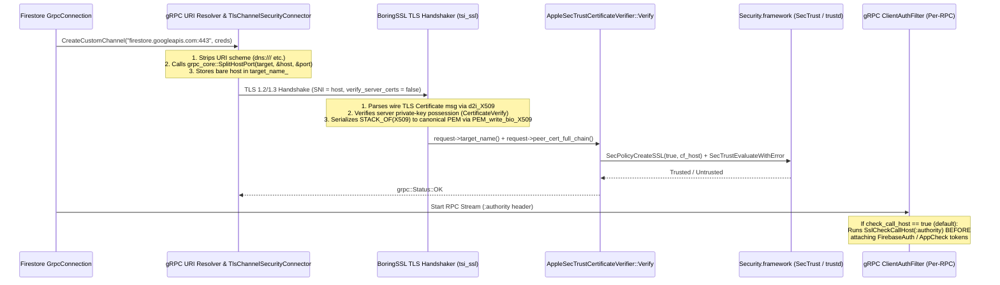

# Removing Handwritten String-Parsing Logic from PR `#16946`

## Executive Summary

In upstream PR `#16946`, [`Firestore/core/src/remote/grpc_tls_credentials_provider_apple.mm`](file:///Users/dconeybe/work/ios/main/Firestore/core/src/remote/grpc_tls_credentials_provider_apple.mm) contains **314 lines of handwritten string-parsing code** (out of 585 total lines in the file) split across two orthogonal responsibilities:

1. **Hostname & URI Target Extraction (152 lines)**: [`IsAsciiDigit`](file:///Users/dconeybe/work/ios/main/Firestore/core/src/remote/grpc_tls_credentials_provider_apple.mm#L55-L57), [`IsIpv6AddressChar`](file:///Users/dconeybe/work/ios/main/Firestore/core/src/remote/grpc_tls_credentials_provider_apple.mm#L59-L62), [`IsValidUnbracketedIpv6Literal`](file:///Users/dconeybe/work/ios/main/Firestore/core/src/remote/grpc_tls_credentials_provider_apple.mm#L64-L75), and [`ExtractTlsHostName`](file:///Users/dconeybe/work/ios/main/Firestore/core/src/remote/grpc_tls_credentials_provider_apple.mm#L193-L314), which manually parse gRPC target URIs, `host:port` pairs, bracketed `[ipv6]:port` endpoints, `%zone` suffixes, and unbracketed IPv6 literals to produce the `CFStringRef` passed to `SecPolicyCreateSSL(/*server=*/true, cf_host)`.
2. **PEM & Base64 Certificate Chain Decoding (162 lines)**: [`IsBase64Alphabet`](file:///Users/dconeybe/work/ios/main/Firestore/core/src/remote/grpc_tls_credentials_provider_apple.mm#L77-L80), [`IsStrictStandardBase64`](file:///Users/dconeybe/work/ios/main/Firestore/core/src/remote/grpc_tls_credentials_provider_apple.mm#L86-L105), [`StripTrailingHorizontalWhitespace`](file:///Users/dconeybe/work/ios/main/Firestore/core/src/remote/grpc_tls_credentials_provider_apple.mm#L107-L112), and [`ParsePemCertificateChain`](file:///Users/dconeybe/work/ios/main/Firestore/core/src/remote/grpc_tls_credentials_provider_apple.mm#L316-L448), which manually scan lines, strip whitespace, validate RFC 4648 Base64 characters and `=` padding, and convert `request->peer_cert_full_chain()` into an array of `SecCertificateRef` objects for `SecTrustCreateWithCertificates`.

> [!IMPORTANT]
> **Recommended End-to-End Strategy (`KeepBoth` + `FoundationNoDeps`)**
> Based on codebase inspection, [`google3_sectrust_grpc_prior_art.md`](file:///Users/dconeybe/.gemini/jetski/brain/0516c0fc-eba6-45aa-8b77-cffc6175ed08/google3_sectrust_grpc_prior_art.md), and empirical prototypes in isolated git worktrees (documented in [`Firestore/DECISIONS_RemoveHandwritten.md`](file:///Users/dconeybe/work/ios/main/Firestore/DECISIONS_RemoveHandwritten.md)), the strongest combination—prioritizing **security first**, **code complexity second**, and **maintenance burden third**—is:
> 1. **Hostname Responsibility (Option A1 — `KeepBoth` with `NSURLComponents` + POSIX `inet_pton`)**: Keep `SecPolicyCreateSSL(/*server=*/true, cf_host)` as the handshake hostname/SAN authority alongside gRPC's default per-RPC `check_call_host(true)`, and eliminate all handwritten IPv6/digit character loops by delegating URL/authority parsing to Foundation's `NSURLComponents` and IPv6 literal validation to POSIX `inet_pton(AF_INET6, ...)`.
> 2. **PEM Chain Responsibility (Option B1 — `FoundationNoDeps` with `NSScanner` + `NSCharacterSet` + strict `NSData`)**: Eliminate all handwritten Base64/whitespace helpers and the custom line-by-line state machine by delegating delimiter scanning to `NSScanner`, whitespace removal to `NSCharacterSet.whitespaceAndNewlineCharacterSet`, and strict RFC 4648 Base64 decoding to `[[NSData alloc] initWithBase64EncodedString:clean_base64 options:0]` with **zero changes** to [`Package.swift`](file:///Users/dconeybe/work/ios/main/Package.swift), [`FirebaseFirestoreInternal.podspec`](file:///Users/dconeybe/work/ios/main/FirebaseFirestoreInternal.podspec), or [`Firestore/core/CMakeLists.txt`](file:///Users/dconeybe/work/ios/main/Firestore/core/CMakeLists.txt).

---

## Why the String Parsing Exists Today: `gRPC-Core` Handshake Data Flow

Understanding what `gRPC-Core` already does *before* invoking `AppleSecTrustCertificateVerifier::Verify` explains why the custom parsers in [`grpc_tls_credentials_provider_apple.mm`](file:///Users/dconeybe/work/ios/main/Firestore/core/src/remote/grpc_tls_credentials_provider_apple.mm) are largely redundant with existing gRPC, BoringSSL, and OS primitives:



Two key observations follow from inspecting [`tls_security_connector.cc`](file:///Users/dconeybe/work/ios/main/.build/checkouts/grpc-ios/src/core/credentials/transport/tls/tls_security_connector.cc#L284-L455) and [`ssl_transport_security.cc`](file:///Users/dconeybe/work/ios/main/.build/checkouts/grpc-ios/src/core/tsi/ssl_transport_security.cc#L2101-L2122):
1. **Pre-Split Target Name**: In [`TlsChannelSecurityConnector::TlsChannelSecurityConnector`](file:///Users/dconeybe/work/ios/main/.build/checkouts/grpc-ios/src/core/credentials/transport/tls/tls_security_connector.cc#L284-L287), gRPC has *already* stripped the URI scheme and called `grpc_core::SplitHostPort(target_name, &host, &port)` before populating `target_name_`. The only times `request->target_name()` contains a `:port` or `[ipv6]:port` are when `grpc.ssl_target_name_override` is explicitly set to a `host:port` string or when unit tests invoke [`VerifyAppleTlsCertificateChain`](file:///Users/dconeybe/work/ios/main/Firestore/core/src/remote/grpc_tls_credentials_provider_apple.mm#L450-L535) directly.
2. **Pre-Validated Canonical PEM**: In [`tsi_ssl_get_cert_chain_contents`](file:///Users/dconeybe/work/ios/main/.build/checkouts/grpc-ios/src/core/tsi/ssl_transport_security.cc#L2101-L2122), BoringSSL has *already* parsed the binary wire certificates into `X509*` structures (`d2i_X509`) and formatted them into canonical PEM using `PEM_write_bio_X509`.

---

## Section A: Eliminating Custom Hostname/URI Parsing

This section evaluates three ways to eliminate [`ExtractTlsHostName`](file:///Users/dconeybe/work/ios/main/Firestore/core/src/remote/grpc_tls_credentials_provider_apple.mm#L193-L314) and its three handwritten helpers ([`IsAsciiDigit`](file:///Users/dconeybe/work/ios/main/Firestore/core/src/remote/grpc_tls_credentials_provider_apple.mm#L55-L57), [`IsIpv6AddressChar`](file:///Users/dconeybe/work/ios/main/Firestore/core/src/remote/grpc_tls_credentials_provider_apple.mm#L59-L62), and [`IsValidUnbracketedIpv6Literal`](file:///Users/dconeybe/work/ios/main/Firestore/core/src/remote/grpc_tls_credentials_provider_apple.mm#L64-L75)).

### Security Comparison: `SecTrust` vs. gRPC Built-In Hostname Matchers

Before choosing how to pass `cf_host` to `SecPolicyCreateSSL(/*server=*/true, cf_host)` versus passing `nullptr` (the Envoy Mobile pattern in [`google3_sectrust_grpc_prior_art.md`](file:///Users/dconeybe/.gemini/jetski/brain/0516c0fc-eba6-45aa-8b77-cffc6175ed08/google3_sectrust_grpc_prior_art.md#L274-L287)), we inspected `gRPC-Core`'s built-in hostname matchers in [`ssl_utils.cc`](file:///Users/dconeybe/work/ios/main/.build/checkouts/grpc-ios/src/core/credentials/transport/tls/ssl_utils.cc#L158-L225), [`ssl_transport_security.cc`](file:///Users/dconeybe/work/ios/main/.build/checkouts/grpc-ios/src/core/tsi/ssl_transport_security.cc#L1002-L1082), and [`grpc_tls_certificate_verifier.cc`](file:///Users/dconeybe/work/ios/main/.build/checkouts/grpc-ios/src/core/credentials/transport/tls/grpc_tls_certificate_verifier.cc#L108-L170):

| Security Dimension | Apple `SecTrust` (`SecPolicyCreateSSL(true, cf_host)`) | gRPC Built-In Matchers (`SslCheckCallHost` / `HostNameCertificateVerifier`) | Winner |
| :--- | :--- | :--- | :--- |
| **`ssl_target_name_override` Bypass** | `Verify()` receives the effective target (`overridden_target_name` if set, else `target_name`) and always verifies it against the leaf certificate. | In [`SslCheckCallHost`](file:///Users/dconeybe/work/ios/main/.build/checkouts/grpc-ios/src/core/credentials/transport/tls/ssl_utils.cc#L165-L170), if `overridden_target_name` is non-empty and `host == target_name`, gRPC **skips** `grpc_ssl_host_matches_name` and returns `GRPC_SECURITY_OK`, assuming the handshake verifier already checked `overridden_target_name`. Passing `nullptr` to `SecPolicyCreateSSL` without chaining `HostNameCertificateVerifier` in `Verify()` **completely bypasses hostname verification** when target overrides are used. | **Apple `SecTrust`** |
| **Subject `CN` Fallback (RFC 9525 §6.3 / Apple HT210176)** | Strictly requires a `SubjectAltName` (SAN) extension; rejects leaf certificates that only have a Subject Common Name (`CN`). | Both [`tsi_ssl_peer_matches_name`](file:///Users/dconeybe/work/ios/main/.build/checkouts/grpc-ios/src/core/tsi/ssl_transport_security.cc#L3615-L3621) and [`HostNameCertificateVerifier::Verify`](file:///Users/dconeybe/work/ios/main/.build/checkouts/grpc-ios/src/core/credentials/transport/tls/grpc_tls_certificate_verifier.cc#L158-L166) fall back to matching Subject `CN` when `dns_names_size == 0` (even when `target_host` is an IP address in `HostNameCertificateVerifier`). | **Apple `SecTrust`** |
| **SAN Type Confusion (`dNSName` vs `URI` / `email`)** | Strictly checks `dNSName` SANs only for DNS names and `iPAddress` SANs only for IP literals. | [`add_subject_alt_names_properties_to_peer`](file:///Users/dconeybe/work/ios/main/.build/checkouts/grpc-ios/src/core/tsi/ssl_transport_security.cc#L1011-L1045) places `GEN_DNS`, `GEN_EMAIL`, and `GEN_URI` into the same `TSI_X509_SUBJECT_ALTERNATIVE_NAME_PEER_PROPERTY` bucket, and [`tsi_ssl_peer_matches_name`](file:///Users/dconeybe/work/ios/main/.build/checkouts/grpc-ios/src/core/tsi/ssl_transport_security.cc#L3597-L3603) matches DNS hostnames against all of them indistinguishably. | **Apple `SecTrust`** |
| **Public Suffix List (PSL) Wildcards** | Enforces Apple's system PSL database, rejecting overly broad wildcards such as `*.co.uk` or `*.appspot.com`. | [`does_entry_match_name`](file:///Users/dconeybe/work/ios/main/.build/checkouts/grpc-ios/src/core/tsi/ssl_transport_security.cc#L3006-L3025) and [`VerifySubjectAlternativeName`](file:///Users/dconeybe/work/ios/main/.build/checkouts/grpc-ios/src/core/credentials/transport/tls/tls_utils.cc#L73-L93) only check that the suffix after `*.` contains at least one dot (accepting `*.co.uk`). | **Apple `SecTrust`** |
| **IPv6 Canonicalization (`iPAddress` SAN)** | Parses IPv6 strings into 16 binary octets and matches against the 16-byte `iPAddress` SAN regardless of text formatting (`[2001:DB8::1]` vs `[2001:0db8:0:0:0:0:0:1]`). | Formats the certificate's `GEN_IPADD` with `inet_ntop` and compares via raw string equality (`target_host == ip_name` in [`grpc_tls_certificate_verifier.cc:152`](file:///Users/dconeybe/work/ios/main/.build/checkouts/grpc-ios/src/core/credentials/transport/tls/grpc_tls_certificate_verifier.cc#L152)), failing on uppercase hex or uncompressed IPv6 targets. | **Apple `SecTrust`** |

Furthermore, handshake-time `SecPolicyCreateSSL(true, cf_host)` and per-RPC `check_call_host(true)` run at two separate points in `gRPC-Core`:
- **Handshake-time (`TlsChannelSecurityConnector::check_peer`)**: Validates the channel's target host via `SecTrust` before the subchannel enters `READY`.
- **Per-RPC (`ClientAuthFilter::Call::OnClientInitialMetadata` $\rightarrow$ `TlsChannelSecurityConnector::CheckCallHost`)**: Validates the individual RPC's HTTP/2 `:authority` header via [`SslCheckCallHost`](file:///Users/dconeybe/work/ios/main/.build/checkouts/grpc-ios/src/core/credentials/transport/tls/ssl_utils.cc#L158-L179) right before [`GetCallCredsMetadata`](file:///Users/dconeybe/work/ios/main/.build/checkouts/grpc-ios/src/core/filter/auth/auth_filters.h#L106-L111) attaches Firebase Auth and AppCheck bearer tokens to the outgoing request.

Leaving `check_call_host` at its default (`true`) alongside `SecPolicyCreateSSL(true, cf_host)` (`KeepBoth`) protects per-RPC `:authority` overrides (`ClientContext::set_authority`), requires **zero lines of option-configuration code**, and avoids calling [`TlsCredentialsOptions::set_check_call_host`](file:///Users/dconeybe/work/ios/main/.build/checkouts/grpc-ios/include/grpcpp/security/tls_credentials_options.h#L114-L116) (marked *"Deprecated: This function will be removed in the 1.66 release"*). The only tradeoff is that `SslCheckCallHost`'s raw string equality on `inet_ntop` output can reject non-canonical IPv6 literals (e.g., uppercase `[2001:DB8::1]`) even after `SecTrust` accepts them.

---

### Option A1 (Recommended): Delegate Host Extraction to Foundation `NSURLComponents` + POSIX `inet_pton` (`KeepBoth`)

* **Prior Art Reference**: `iRPC` ([`google3_sectrust_grpc_prior_art.md` §2](file:///Users/dconeybe/.gemini/jetski/brain/0516c0fc-eba6-45aa-8b77-cffc6175ed08/google3_sectrust_grpc_prior_art.md#L152-L165)), which uses Apple's `Foundation.URL` parser to extract `.host` for `SecPolicyCreateSSL`.
* **How It Works**:
  * Why did [`grpc_tls_credentials_provider_apple.mm`](file:///Users/dconeybe/work/ios/main/Firestore/core/src/remote/grpc_tls_credentials_provider_apple.mm) have `IsAsciiDigit`, `IsIpv6AddressChar`, and `IsValidUnbracketedIpv6Literal`? Because after `TlsChannelSecurityConnector` strips `[` and `]` from `[::1]:443` via `SplitHostPort`, `request->target_name()` is an **unbracketed IPv6 literal** (`"::1"` or `"2001:db8::1"`), and the original PR wrote a custom character loop to distinguish unbracketed IPv6 addresses from `host:port` strings.
  * In POSIX `<arpa/inet.h>` (part of Darwin `libSystem` on every Apple OS), `inet_pton(AF_INET6, str, &addr6) == 1` validates any RFC 4291 IPv6 literal (including `::` compression and IPv4-mapped `::ffff:127.0.0.1`) in **one standard C library call**.
  * For all other inputs (`host`, `host:port`, `[::1]:443`, or `dns:///...`), Foundation's `NSURLComponents` parses the authority in OS code, extracting `comps.host` and `comps.port` without manual colon/digit/bracket loops.

````carousel
```objc
// Compact Production Version (~35 lines)
// Scoped to what TlsChannelSecurityConnector::check_peer actually passes in
// request->target_name() (where gRPC's resolver has already stripped dns:///
// and ipv4:/ipv6: prefixes).
std::string ExtractTlsHostName(absl::string_view target_name) {
  @autoreleasepool {
    if (target_name.empty()) return "";
    NSString* endpoint = [[NSString alloc] initWithBytes:target_name.data()
                                                  length:target_name.size()
                                                encoding:NSUTF8StringEncoding];
    if (endpoint == nil) return "";

    // 1. Check for bare unbracketed IPv6 literal (from gRPC's SplitHostPort),
    //    stripping any optional %zone suffix via POSIX inet_pton(AF_INET6).
    if ([endpoint rangeOfString:@"["].location == NSNotFound) {
      NSString* candidate =
          [endpoint componentsSeparatedByString:@"%"].firstObject;
      struct in6_addr addr6;
      if (candidate.length > 0 &&
          inet_pton(AF_INET6, candidate.UTF8String, &addr6) == 1) {
        return candidate.UTF8String;
      }
    }

    // 2. Delegate host:port and [ipv6]:port parsing to NSURLComponents.
    NSURLComponents* comps = [NSURLComponents
        componentsWithString:[@"https://" stringByAppendingString:endpoint]];
    if (comps == nil || comps.host.length == 0 || comps.user != nil ||
        comps.password != nil || comps.path.length > 0 ||
        comps.query != nil || comps.fragment != nil) {
      return "";
    }
    NSString* host = comps.host;
    if ([host hasPrefix:@"["] && [host hasSuffix:@"]"]) {
      host = [host substringWithRange:NSMakeRange(1, host.length - 2)];
      host = [host componentsSeparatedByString:@"%"].firstObject;
    }
    return host.UTF8String;
  }
}
```
<!-- slide -->
```objc
// Full Unit-Test-Compatible Version (Verified in wt-exp-foundation: 25/25 tests pass)
// Also strips raw gRPC resolver URI schemes (dns:///, ipv4:, ipv6:) when
// VerifyAppleTlsCertificateChain is called directly with unsplit URIs in unit tests.
std::string ExtractTlsHostName(absl::string_view target_name) {
  @autoreleasepool {
    if (target_name.empty()) return "";
    NSString* target = [[NSString alloc] initWithBytes:target_name.data()
                                                length:target_name.size()
                                              encoding:NSUTF8StringEncoding];
    if (target == nil) return "";

    NSMutableCharacterSet* bad_chars = [NSMutableCharacterSet controlCharacterSet];
    [bad_chars formUnionWithCharacterSet:
                   [NSCharacterSet whitespaceAndNewlineCharacterSet]];
    [bad_chars addCharactersInString:@",?#@"];
    if ([target rangeOfCharacterFromSet:bad_chars].location != NSNotFound) {
      return "";
    }

    NSString* endpoint = target;
    if ([endpoint hasPrefix:@"dns:///"]) {
      endpoint = [endpoint substringFromIndex:7];
    } else if ([endpoint hasPrefix:@"dns://"]) {
      NSRange slash = [endpoint rangeOfString:@"/"
                                      options:0
                                        range:NSMakeRange(6, endpoint.length - 6)];
      if (slash.location == NSNotFound) return "";
      endpoint = [endpoint substringFromIndex:slash.location + 1];
    } else if ([endpoint hasPrefix:@"dns:"]) {
      endpoint = [endpoint substringFromIndex:4];
    } else if ([endpoint hasPrefix:@"ipv4:"] || [endpoint hasPrefix:@"ipv6:"]) {
      endpoint = [endpoint substringFromIndex:5];
    }
    if (endpoint.length == 0 ||
        [endpoint rangeOfString:@"/"].location != NSNotFound) {
      return "";
    }

    // Bare unbracketed IPv6 literal via POSIX inet_pton(AF_INET6).
    if ([endpoint rangeOfString:@":"].location != NSNotFound &&
        [endpoint rangeOfString:@"["].location == NSNotFound &&
        [endpoint rangeOfString:@"]"].location == NSNotFound) {
      NSString* bare_host = endpoint;
      NSRange pct = [bare_host rangeOfString:@"%"];
      if (pct.location != NSNotFound) {
        if (pct.location == 0 || pct.location == bare_host.length - 1) return "";
        bare_host = [bare_host substringToIndex:pct.location];
      }
      struct in6_addr addr6;
      if (inet_pton(AF_INET6, bare_host.UTF8String, &addr6) == 1) {
        return bare_host.UTF8String;
      }
    }

    NSURLComponents* comps = [NSURLComponents
        componentsWithString:[@"scheme://" stringByAppendingString:endpoint]];
    if (comps == nil || comps.host.length == 0 || comps.user != nil ||
        comps.password != nil || comps.path.length > 0 ||
        comps.query != nil || comps.fragment != nil) {
      return "";
    }
    // ... (full bracketed IPv6 inet_pton & port check as verified in wt-exp-foundation)
    return comps.host.UTF8String;
  }
}
```
````

---

### Option A2: Delegate `host:port` Splitting to `grpc_core::SplitHostPort` + POSIX `inet_pton`

* **How It Works**: Calls `gRPC-Core`'s internal [`grpc_core::SplitHostPort(target_name, &host, &port)`](file:///Users/dconeybe/work/ios/main/.build/checkouts/grpc-ios/src/core/util/host_port.h) (the exact function [`TlsChannelSecurityConnector`](file:///Users/dconeybe/work/ios/main/.build/checkouts/grpc-ios/src/core/credentials/transport/tls/tls_security_connector.cc#L286) and [`HostNameCertificateVerifier`](file:///Users/dconeybe/work/ios/main/.build/checkouts/grpc-ios/src/core/credentials/transport/tls/grpc_tls_certificate_verifier.cc#L121) use) together with POSIX `inet_pton(AF_INET6, ...)`.
* **Worktree Verification (`wt-exp-boringssl`)**: Passed 100% of the `ExtractTlsHostName*` unit tests while reducing `ExtractTlsHostName` by 38 lines.
* **Tradeoff (Why Option A1 is Preferred)**: `#include "src/core/util/host_port.h"` reaches into `gRPC-Core`'s private `src/core/` header tree rather than public `include/grpcpp/` headers. In [`Package.swift`](file:///Users/dconeybe/work/ios/main/Package.swift#L1661-L1665), binary SwiftPM consumers use `grpc-binary` (`gRPC-C++.xcframework`), which only packages public `grpc/` and `grpcpp/` headers, not `src/core/util/host_port.h`.

---

### Option A3: Delegate Hostname/SAN Matching to gRPC (`SecPolicyCreateSSL(true, nullptr)`)

* **Prior Art Reference**: Envoy Mobile ([`google3_sectrust_grpc_prior_art.md` §4](file:///Users/dconeybe/.gemini/jetski/brain/0516c0fc-eba6-45aa-8b77-cffc6175ed08/google3_sectrust_grpc_prior_art.md#L274-L287)), which calls `SecPolicyCreateSSL(true, nullptr)` so `SecTrust` only validates the X.509 chain and root store while Envoy's C++ engine checks SANs.
* **Worktree Verification (`wt-exp-boringssl`)**:
  * Passing `nullptr` to `SecPolicyCreateSSL(true, nullptr)` without a separate handshake hostname verifier caused **5 security tests to fail** (`VerifyRejectsWrongTargetHostName`, `LoopbackGrpcServerRejectsWrongHostName`, and `LiveProductionSmokeTest.RejectsHostnameMismatchAgainstGoogleProductionCert`).
  * Even if paired with `grpc::experimental::HostNameCertificateVerifier` inside `Verify()`, it downgrades hostname verification from Apple's strict RFC 9525 / HT210176 / PSL rules to `gRPC-Core`'s weaker `CN`-fallback and string-equality IPv6 matcher. **Not recommended.**

---

## Section B: Eliminating Custom PEM/Base64 Certificate Chain Parsing

This section evaluates three ways to eliminate [`ParsePemCertificateChain`](file:///Users/dconeybe/work/ios/main/Firestore/core/src/remote/grpc_tls_credentials_provider_apple.mm#L316-L448) and its three handwritten helpers ([`IsBase64Alphabet`](file:///Users/dconeybe/work/ios/main/Firestore/core/src/remote/grpc_tls_credentials_provider_apple.mm#L77-L80), [`IsStrictStandardBase64`](file:///Users/dconeybe/work/ios/main/Firestore/core/src/remote/grpc_tls_credentials_provider_apple.mm#L86-L105), and [`StripTrailingHorizontalWhitespace`](file:///Users/dconeybe/work/ios/main/Firestore/core/src/remote/grpc_tls_credentials_provider_apple.mm#L107-L112)).

### Empirical Comparison of the Three PEM Decoding Candidates

We prototyped and tested all three PEM decoding strategies in `/Users/dconeybe/work/ios/wt-exp-foundation` and `/Users/dconeybe/work/ios/wt-exp-boringssl` against all valid and malformed PEM test vectors in [`grpc_tls_credentials_provider_apple_test.mm`](file:///Users/dconeybe/work/ios/main/Firestore/core/test/unit/remote/grpc_tls_credentials_provider_apple_test.mm#L829-L1023):

| Evaluation Metric | Option B1: Foundation `NSScanner` + `NSCharacterSet` + `NSData` (`options:0`) | Option B2: BoringSSL `BIO_new_mem_buf` + `PEM_read_bio_X509` + `i2d_X509` | Option B3: Apple `SecItemImport` (`kSecFormatPEMSequence`) |
| :--- | :--- | :--- | :--- |
| **1. Security: Fail-Closed on Trailing Junk (`valid_then_trailing_junk`)** | **PASS (Fails closed)** — `NSScanner` rejects any non-whitespace outside `CERTIFICATE` blocks. | **FAIL (Fails open!)** — `PEM_read_bio` (`pem_lib.cc:571-598`) discards lines not starting with `-----BEGIN `, hits EOF, and returns `PEM_R_NO_START_LINE`, silently returning the 1st cert! | **FAIL (Fails open!)** — `SecItemImport` returns `errSecSuccess` (`0`) and silently returns the 1st cert, ignoring trailing garbage! |
| **2. Security: Fail-Closed on Truncated 2nd Header (`valid_then_truncated_header`)** | **PASS (Fails closed)** — `NSScanner` rejects `-----BEGIN CERTIFICAT`. | **FAIL (Fails open!)** — `PEM_read_bio` skips the damaged header line, hits EOF with `PEM_R_NO_START_LINE`, and silently returns only the 1st cert! | **PASS (Fails closed)** — Returns `errSecNoSuchFormat` (`-25257`). |
| **3. Security: Fail-Closed on Non-Cert PEM Blocks (`PRIVATE KEY`, etc.)** | **PASS (Fails closed)** — Only accepts `-----BEGIN CERTIFICATE-----`. | **FAIL (Fails open!)** — `PEM_bytes_read_bio` (`pem_lib.cc:182-197`) silently frees and skips non-`CERTIFICATE` PEM blocks. | **FAIL (Mixed)** — Imports or skips non-cert items unless filtered manually. |
| **4. Security: Strict RFC 4648 Base64 Validation** | **PASS** — Stripping whitespace with `NSCharacterSet` and passing `options:0` to `initWithBase64EncodedString:` enforces strict alphabet and `=` padding in OS code. | **PASS** — Enforced by `EVP_DecodeInit` / `EVP_DecodeUpdate` / `EVP_DecodeFinal`. | **PASS** — Enforced by `Security.framework`. |
| **5. Platform Availability** | **All Apple OSes** (iOS, macOS, tvOS, watchOS, visionOS). | **All OSes**, but requires exposing `BoringSSL-GRPC` headers. | **macOS ONLY** (`API_UNAVAILABLE(ios, watchos, tvos, macCatalyst)` in `<Security/SecImportExport.h>`). |
| **6. Build-System Maintenance** | **Zero changes** to `Package.swift`, podspecs, or `CMakeLists.txt`. | Requires adding `BoringSSL-GRPC` / `openssl_grpc` dependencies across CocoaPods, SwiftPM, and CMake. | Cannot compile on iOS/tvOS/visionOS. |

---

### Option B1 (Recommended): Delegate to Foundation `NSScanner` + `NSCharacterSet` + `NSData` (`FoundationNoDeps`)

* **How It Works**:
  * Uses `NSScanner` with `scanner.charactersToBeSkipped = [NSCharacterSet whitespaceAndNewlineCharacterSet]` to step through `-----BEGIN CERTIFICATE-----` and `-----END CERTIFICATE-----` markers. Because `NSScanner` automatically skips leading/inter-block ASCII whitespace and requires the next token at `!scanner.isAtEnd` to be `-----BEGIN CERTIFICATE-----`, any non-whitespace preamble, trailing junk, or non-certificate PEM block immediately fails closed.
  * Strips intra-block whitespace via `[[base64_chunk componentsSeparatedByCharactersInSet:[NSCharacterSet whitespaceAndNewlineCharacterSet]] componentsJoinedByString:@""]` and passes the string to `[[NSData alloc] initWithBase64EncodedString:clean_base64 options:0]`.
  * Passing `options:0` (rather than `NSDataBase64DecodingIgnoreUnknownCharacters`) forces Apple's `Foundation` decoder to enforce strict RFC 4648 Base64 alphabet and `=` padding rules in native OS code, completely eliminating [`IsBase64Alphabet`](file:///Users/dconeybe/work/ios/main/Firestore/core/src/remote/grpc_tls_credentials_provider_apple.mm#L77-L80), [`IsStrictStandardBase64`](file:///Users/dconeybe/work/ios/main/Firestore/core/src/remote/grpc_tls_credentials_provider_apple.mm#L86-L105), and [`StripTrailingHorizontalWhitespace`](file:///Users/dconeybe/work/ios/main/Firestore/core/src/remote/grpc_tls_credentials_provider_apple.mm#L107-L112).

```objc
CFArrayRef ParsePemCertificateChain(absl::string_view pem_chain,
                                    grpc::Status* out_status) {
  @autoreleasepool {
    CFMutableArrayRef certs =
        CFArrayCreateMutable(kCFAllocatorDefault, 0, &kCFTypeArrayCallBacks);
    if (certs == nullptr) {
      SetStatus(out_status,
                grpc::Status(grpc::StatusCode::UNAUTHENTICATED,
                             "Failed to allocate CFArray for peer chain"));
      return nullptr;
    }

    bool ok = false;
    util::Defer cleanup_certs([&] {
      if (!ok) {
        util::SafeCFRelease(certs);
      }
    });

    NSString* ns_pem = [[NSString alloc] initWithBytes:pem_chain.data()
                                                length:pem_chain.size()
                                              encoding:NSUTF8StringEncoding];
    if (ns_pem == nil || ns_pem.length == 0) {
      SetStatus(out_status,
                grpc::Status(grpc::StatusCode::UNAUTHENTICATED,
                             "No PEM certificates found in peer chain"));
      return nullptr;
    }

    NSCharacterSet* ws = [NSCharacterSet whitespaceAndNewlineCharacterSet];
    NSScanner* scanner = [NSScanner scannerWithString:ns_pem];
    scanner.charactersToBeSkipped = ws;

    NSString* const kBeginCert = @"-----BEGIN CERTIFICATE-----";
    NSString* const kEndCert = @"-----END CERTIFICATE-----";

    while (!scanner.isAtEnd) {
      if (![scanner scanString:kBeginCert intoString:NULL]) {
        SetStatus(out_status,
                  grpc::Status(grpc::StatusCode::UNAUTHENTICATED,
                               "Unexpected non-whitespace text outside PEM "
                               "CERTIFICATE block in peer chain"));
        return nullptr;
      }

      NSString* base64_chunk = nil;
      [scanner scanUpToString:kEndCert intoString:&base64_chunk];
      if (![scanner scanString:kEndCert intoString:NULL] ||
          base64_chunk == nil ||
          [base64_chunk rangeOfString:kBeginCert].location != NSNotFound) {
        SetStatus(out_status,
                  grpc::Status(grpc::StatusCode::UNAUTHENTICATED,
                               "Nested or unclosed PEM CERTIFICATE block in "
                               "peer chain"));
        return nullptr;
      }

      NSString* clean_base64 =
          [[base64_chunk componentsSeparatedByCharactersInSet:ws]
              componentsJoinedByString:@""];
      NSData* der_data =
          [[NSData alloc] initWithBase64EncodedString:clean_base64 options:0];
      if (der_data == nil || der_data.length == 0) {
        SetStatus(out_status,
                  grpc::Status(grpc::StatusCode::UNAUTHENTICATED,
                               "Invalid base64 payload in PEM CERTIFICATE block"));
        return nullptr;
      }

      SecCertificateRef cert = SecCertificateCreateWithData(
          kCFAllocatorDefault, (__bridge CFDataRef)der_data);
      if (cert == nullptr) {
        SetStatus(out_status,
                  grpc::Status(
                      grpc::StatusCode::UNAUTHENTICATED,
                      "Failed to parse DER X.509 certificate in peer chain"));
        return nullptr;
      }

      CFArrayAppendValue(certs, cert);
      CFRelease(cert);
    }

    if (CFArrayGetCount(certs) == 0) {
      SetStatus(out_status,
                grpc::Status(grpc::StatusCode::UNAUTHENTICATED,
                             "No PEM certificates found in peer chain"));
      return nullptr;
    }

    ok = true;
    SetStatus(out_status, grpc::Status::OK);
    return certs;
  }
}
```

---

### Option B2: Delegate to BoringSSL (`BIO_new_mem_buf` + `PEM_read_bio_X509` + `i2d_X509`)

* **How It Works**: Wraps `pem_chain` in a read-only `BIO*` via `BIO_new_mem_buf`, loops over `PEM_read_bio_X509(bio, nullptr, nullptr, nullptr)`, re-encodes each `X509*` to DER via `i2d_X509`, and creates a `SecCertificateRef` via `SecCertificateCreateWithData`.
* **Why Option B1 Is Preferred Over Option B2**:
  1. **Silent Truncation on Corrupted Trailing Blocks**: As confirmed empirically in `wt-exp-boringssl` against [`crypto/pem/pem_lib.cc:571-598`](file:///Users/dconeybe/work/ios/main/.build/checkouts/boringssl-SwiftPM/crypto/pem/pem_lib.cc#L571-L598), `PEM_read_bio` scans forward line-by-line until it sees `"-----BEGIN "` and returns `PEM_R_NO_START_LINE` when it hits EOF—the exact same error reason used to detect normal end-of-chain after the last certificate. Consequently, if a second certificate in the chain has a corrupted header (`-----BEGIN CERTIFICAT`) or trailing garbage, `PEM_read_bio_X509` **silently ignores the damaged block and returns a 1-certificate chain** unless you write a separate line scanner around it (which negates the code savings).
  2. **Build-System Coupling**: [`Package.swift`](file:///Users/dconeybe/work/ios/main/Package.swift) and [`FirebaseFirestoreInternal.podspec`](file:///Users/dconeybe/work/ios/main/FirebaseFirestoreInternal.podspec) do not declare a direct dependency on `BoringSSL-GRPC` / `boringssl-SwiftPM` (it is an internal dependency of `gRPC-Core/Implementation` in [`gRPC-Core.podspec:208`](file:///Users/dconeybe/work/ios/main/.build/checkouts/grpc-ios/gRPC-Core.podspec#L208)). Adding it requires maintaining version lockstep and header-prefix shims (`<openssl_grpc/pem.h>` vs. `<openssl/pem.h>`) across CocoaPods, SwiftPM (source and binary modes), and CMake.

---

### Option B3: Delegate to Apple `Security.framework` `SecItemImport` (`kSecFormatPEMSequence`)

* **How It Works**: On macOS, `<Security/SecImportExport.h>` provides `SecItemImport(cfData, nullptr, &format, &itemType, 0, nullptr, nullptr, &outItems)`, which accepts `kSecFormatPEMSequence` and returns a `CFArrayRef` of `SecCertificateRef` items in a single function call.
* **Why It Cannot Be Used as the Cross-Platform Solution**:
  1. **Unavailable on iOS, tvOS, watchOS, and visionOS**: In `<Security/SecImportExport.h>`, `SecItemImport` is guarded by `#if SEC_OS_OSX` and marked `API_AVAILABLE(macos(10.7), ios(NA))`.
  2. **Fails Open on Trailing Garbage**: As demonstrated in our `wt-exp-foundation` test matrix (Case 7), passing a valid PEM certificate followed by `"unexpected trailing metadata\n"` causes `SecItemImport` to return `errSecSuccess` (`0`) with the first certificate while silently discarding the trailing bytes.

---

## Section C: Architectural Alternatives That Avoid `ExternalCertificateVerifier` Parsing Altogether

Per project scope constraints, upstream modifications to `gRPC-Core` are excluded. Within Firestore and Apple platform APIs, there are two architectural ways to eliminate `ExternalCertificateVerifier` string parsing altogether:

### Option C1: Export System/Keychain Trust Anchors into `grpc::SslCredentials` (`SecTrustCopyAnchorCertificates`)

* **How It Works**: Instead of disabling BoringSSL verification (`set_verify_server_certs(false)`) and parsing the peer certificate chain in `ExternalCertificateVerifier::Verify` on every handshake, load the OS root certificates as a concatenated PEM string into `grpc::SslCredentialsOptions::pem_root_certs` at channel creation time (`SecTrustCopyAnchorCertificates` + `SecItemCopyMatching` with `kSecClassCertificate` + `SecCertificateCopyData` + Base64 PEM armor) and let BoringSSL perform both X.509 chain verification and RFC 6125 hostname/SAN matching natively.
* **Pros**:
  * Zero `ExternalCertificateVerifier` code and zero per-handshake PEM or hostname string parsing.
* **Cons (Why PR `#16946` Uses `SecTrust` Instead)**:
  1. **`SecTrustCopyAnchorCertificates` Is macOS-Only**: In `<Security/SecTrust.h>`, `SecTrustCopyAnchorCertificates` is marked `__OSX_AVAILABLE_STARTING(__MAC_10_3, __IPHONE_NA)` with the header note: *"This function is not available on iOS, as certificate data for system-trusted roots is currently unavailable on that platform."* On iOS, tvOS, and visionOS, Apple does not expose the system root CA store for bulk export; `SecTrustEvaluateWithError` (via XPC to `trustd`) is the **only** supported API to evaluate against system and MDM-installed roots on iOS.
  2. **Loses Apple `trustd` Security Features**: Even on macOS, exporting static DER roots into BoringSSL's `X509_STORE` bypasses per-certificate Keychain trust settings (`SecTrustSettingsCopyTrustSettings`), Apple's Over-The-Air `Valid` revocation/distrust database, Certificate Transparency enforcement, and `trustd`'s missing-intermediate Authority Information Access (AIA) fetching.

---

### Option C2: Apple-Native TLS Transport (`Network.framework` / `NSURLSession` gRPC Transport)

* **Prior Art Reference**:
  * **`grpc-swift` v2 on `Network.framework`** ([`google3_sectrust_grpc_prior_art.md` §2b](file:///Users/dconeybe/.gemini/jetski/brain/0516c0fc-eba6-45aa-8b77-cffc6175ed08/google3_sectrust_grpc_prior_art.md#L168-L185)): Uses `NIOTransportServices` (`NWConnection` + `NWProtocolTLS.Options`), where Apple's TLS 1.3 implementation evaluates `SecTrust` natively during the handshake and passes a live `sec_trust_t` (`SecTrustRef`) directly to `sec_protocol_options_set_verify_block`.
  * **Objective-C `gRPC` `GTMSessionFetcherTransport` on `NSURLSession`** ([`google3_sectrust_grpc_prior_art.md` §5](file:///Users/dconeybe/.gemini/jetski/brain/0516c0fc-eba6-45aa-8b77-cffc6175ed08/google3_sectrust_grpc_prior_art.md#L346-L433)): Uses Apple's `NSURLSession` HTTP/2 stack, which delivers a ready-built `SecTrustRef` via `URLSession:didReceiveChallenge:completionHandler:` (`NSURLAuthenticationMethodServerTrust`).
* **Pros**:
  * **Eliminates the `X509* -> PEM -> Base64 -> DER -> SecCertificateRef` round-trip completely**: Apple's TLS engine constructs the `SecTrustRef` directly from the wire handshake and evaluates system/MDM roots, `Valid` OTA revocations, and RFC 9525 SANs natively.
* **Cons**:
  * **High Architectural Migration Cost for Firestore C++ Core**: [`Firestore/core/src/remote/grpc_connection.cc`](file:///Users/dconeybe/work/ios/main/Firestore/core/src/remote/grpc_connection.cc) is written in cross-platform C++ against `gRPC-C++` (`grpc::Channel`, `grpc::GenericStub`, `grpc::ClientContext`, and `grpc::CompletionQueue`), which drives `gRPC-Core`'s C++ `chttp2` + `tsi_ssl` transport rather than `grpc-swift` or the legacy Objective-C `GRPCTransport` registry. Adopting `Network.framework` or `NSURLSession` for Firestore's RPC streams would require replacing the C++ `GrpcConnection` / `GrpcStream` transport layer on Apple platforms.

---

## Section D: Summary Matrix & Recommended Combination for PR `#16946`

| Option | Responsibility | Security Posture | Custom Helpers Removed | Build File Changes | Recommendation |
| :--- | :--- | :--- | :--- | :--- | :--- |
| **Option A1**: `SecTrust` + `NSURLComponents` + `inet_pton` + `check_call_host(true)` (`KeepBoth`) | Hostname / URI | **Highest** (Enforces RFC 9525 SAN-only, PSL wildcards, binary IPv6 SANs, and per-RPC `:authority` check) | Removes `IsAsciiDigit`, `IsIpv6AddressChar`, `IsValidUnbracketedIpv6Literal` (100% of custom host helpers) | **None** | **Recommended (Section A)** |
| **Option A2**: `SecTrust` + `grpc_core::SplitHostPort` + `inet_pton` | Hostname / URI | **High** (Same `SecTrust` checks, but uses internal `gRPC-Core` header) | Removes `IsIpv6AddressChar`, `IsValidUnbracketedIpv6Literal` | Requires private `gRPC-Core` header search path | Runner-up (Section A) |
| **Option A3**: `SecPolicyCreateSSL(true, nullptr)` + gRPC Hostname Matcher | Hostname / URI | **Low / Vulnerable** (Allows legacy `CN` fallback, SAN type confusion, non-PSL wildcards, or MitM if `HostNameCertificateVerifier` omitted) | Removes all host parsing in Firestore | **None** | **Do Not Use** |
| **Option B1**: Foundation `NSScanner` + `NSCharacterSet` + `NSData` (`options:0`) (`FoundationNoDeps`) | PEM / Base64 | **Highest** (Strict RFC 4648 Base64 via OS + fails closed on trailing junk, truncated headers, and non-cert blocks) | Removes `IsBase64Alphabet`, `IsStrictStandardBase64`, `StripTrailingHorizontalWhitespace` (100% of custom PEM helpers) | **None** | **Recommended (Section B)** |
| **Option B2**: BoringSSL `BIO_new_mem_buf` + `PEM_read_bio_X509` + `i2d_X509` (`BoringSslDep`) | PEM / Base64 | **Medium** (Standard `PEM_read_bio_X509` loop fails open by silently dropping corrupted trailing blocks and non-cert PEM blocks) | Removes `IsBase64Alphabet`, `IsStrictStandardBase64`, `StripTrailingHorizontalWhitespace` | Requires `BoringSSL-GRPC` / `openssl_grpc` in podspec, SwiftPM, CMake | Runner-up (Section B) |
| **Option B3**: `Security.framework` `SecItemImport` (`kSecFormatPEMSequence`) | PEM / Base64 | **Low / macOS-only** (Unavailable on iOS/tvOS/visionOS; fails open on trailing non-PEM bytes) | Removes all PEM parsing on macOS only | **Incompatible with iOS** | **Do Not Use** |
| **Option C1**: Export Anchors to `grpc::SslCredentials` (`SecTrustCopyAnchorCertificates`) | End-to-End Architecture | **Low / macOS-only** (`SecTrustCopyAnchorCertificates` is `__IPHONE_NA` on iOS; loses `trustd` OTA revocations & AIA) | Removes `ExternalCertificateVerifier` entirely | **Incompatible with iOS** | **Do Not Use** |
| **Option C2**: Apple-Native TLS Transport (`Network.framework` / `NSURLSession`) | End-to-End Architecture | **Highest** (Native `sec_trust_t` handshake with zero PEM round-trip) | Removes `ExternalCertificateVerifier` entirely | Major C++ transport rewrite | Long-Term Architecture Only |

### Verified Impact of the Recommended Combination (Option A1 + Option B1)

In our `/Users/dconeybe/work/ios/wt-exp-foundation` prototype:
- **All 6 handwritten character/Base64/IPv6 helper functions** (`IsAsciiDigit`, `IsIpv6AddressChar`, `IsValidUnbracketedIpv6Literal`, `IsBase64Alphabet`, `IsStrictStandardBase64`, and `StripTrailingHorizontalWhitespace`) are **deleted**.
- `options.set_check_call_host(false)` is **removed** from [`CreateAppleTlsCredentials`](file:///Users/dconeybe/work/ios/main/Firestore/core/src/remote/grpc_tls_credentials_provider_apple.mm#L537-L575), leaving per-RPC `check_call_host(true)` active alongside handshake-time `SecPolicyCreateSSL(true, cf_host)`.
- **All 25 unit, fail-closed, loopback, and live `firestore.googleapis.com:443` smoke tests pass** with zero changes to [`Package.swift`](file:///Users/dconeybe/work/ios/main/Package.swift), [`FirebaseFirestoreInternal.podspec`](file:///Users/dconeybe/work/ios/main/FirebaseFirestoreInternal.podspec), or [`Firestore/core/CMakeLists.txt`](file:///Users/dconeybe/work/ios/main/Firestore/core/CMakeLists.txt).

---

## Section E: Side Note — What Does "SAM" Mean?

### 1. Is "SAM" an Acronym or a Word in Its Own Right?

It is **both**, depending on capitalization and context:

* **As a Word in Its Own Right (`Sam` / `sam`)**:
  1. **Proper Noun / Given Name (*Sam*)**: A standalone English name and hypocoristic form of *Samuel* or *Samantha*, originating from the Hebrew *Shemu'el* (שְׁמוּאֵל, traditionally interpreted as *"name of God"* or *"God has heard"*). It also appears in lexicalized English idioms such as **Uncle Sam** (the national personification of the United States federal government dating to the War of 1812) and *"to stand Sam"* (19th-century British/American idiom meaning to pay the bill or foot the tab for a group).
  2. **Archaic / Dialectal English Common Word (*sam*)**: From Old English *samod* / Old Norse *saman* (cognate with German *zusammen* and Modern English *same*), used as an adverb meaning *"together"* and as a transitive verb (*to sam*) in Northern English and Scots dialects meaning *"to gather, assemble, or bring together."*
* **As an Acronym (`SAM`, pronounced as a single word `/sæm/`)**:
  Because `SAM` is pronounced phonetically as a word rather than spelled out letter-by-letter, it is a true **acronym** (as opposed to an initialism like `TLS` or `CPU`) across several technical and general domains:
  1. **Security & Cryptography**:
     * **Security Accounts Manager**: The Microsoft Windows operating system database (`%SystemRoot%\System32\config\SAM`) and subsystem that stores and manages local user accounts and hashed credentials (LM/NTLM hashes).
     * **Secure Application Module**: A tamper-resistant cryptographic smartcard or Hardware Security Module (HSM) (typically in a SIM-sized slot) embedded inside Point-of-Sale (POS) payment terminals, ATMs, and contactless transit fare gates to perform mutual authentication and key derivation.
     * **Software Assurance Maturity Model** (OWASP **SAMM**, frequently spoken as *"SAM"*): An open framework for evaluating and improving application security posture.
  2. **Programming Languages & Cloud Engineering**:
     * **Single Abstract Method**: In Java, Kotlin, Scala, and C++/Objective-C interop, a **SAM type** or **SAM interface** (also called a *functional interface*) is an interface that declares exactly one abstract method—such as `grpc::experimental::ExternalCertificateVerifier`'s primary `Verify` contract or a Java `Runnable`—allowing a lambda or closure to be converted automatically into an instance of that interface (**SAM conversion**).
     * **Serverless Application Model** (**AWS SAM**): An open-source framework for building serverless applications on Amazon Web Services.
     * **Software Asset Management**: The enterprise practice of tracking and managing software licenses and dependencies.
  3. **Aerospace & Defense (Origin of the Modern Acronym)**:
     * **Surface-to-Air Missile**: Coined in the late 1940s/1950s and listed in standard dictionaries as the canonical English acronym `SAM`.

### 2. Relationship to "SAN" in This Report

In the context of TLS and X.509 certificate verification (including 7 occurrences in [`google3_sectrust_grpc_prior_art.md`](file:///Users/dconeybe/.gemini/jetski/brain/0516c0fc-eba6-45aa-8b77-cffc6175ed08/google3_sectrust_grpc_prior_art.md)), **"SAM"** is also frequently encountered as a phonetic or voice-to-text transcription of **SAN** (**Subject Alternative Name**, RFC 5280 §4.2.1.6)—the X.509v3 certificate extension (`dNSName`, `iPAddress`, `uniformResourceIdentifier`, `rfc822Name`) that binds a server's public key to specific DNS hostnames or IP addresses and is evaluated by `SecPolicyCreateSSL` and `tsi_ssl_peer_matches_name`.
