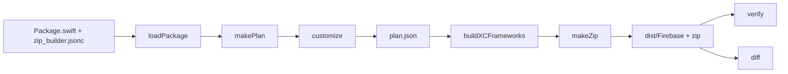

# Zip Builder

A Swift CLI tool for converting a `Package.swift` into a zip of `.xcframework` files, for binary publishing.

Funadamentally, this tool converts a `Package.swift` into an `.xcodeproj`, and then generates
`.xcframework` slices from the given Xcode Project. Those slices are then packaged into a zip.

The zip builder is fundamentally written to be a generic tool for anyone to use; Firebase specific
functionality is instead configured via a [config file](./docs/configuration.md).

## Quick start

A wrapper script is provided via [scripts/zip_builder.sh](/scripts/zip_builder.sh) for easier usage,
and should be ran from the root of the repository.

The script builds the tool and
runs it in the current directory, so the defaults (`.` as the package, `./zip_builder.jsonc` for the config file, and
`build/` as the work directory) point at the repo root.

```bash
# Plan, build, package, then verify: build/dist/Firebase and build/Firebase-$VERSION-latest.zip.
./scripts/zip_builder.sh release --version "13.0.0"
# Check a distribution (a folder or a zip), or compare two.
./scripts/zip_builder.sh verify build/dist/Firebase
./scripts/zip_builder.sh diff old/Firebase build/dist/Firebase
```

For larger repos (eg; Firebase), the first build could take a bit longer than usual; later builds only compile
frameworks that changed (see [Caching](#caching)).

## How it works



1. **loadPackage** loads the package graph with SwiftPM.
2. **makePlan** maps each library target to a framework, straight from SwiftPM's data.
3. **customize** applies the config: merging and renaming frameworks, header visibility,
   platforms, build settings, the zip's folders.
4. **buildXCFrameworks** generates an `.xcodeproj` from the plan, archives it once per
   destination, and creates the `.xcframework`s. Unchanged frameworks come from the cache.
5. **makeZip** lays out the folders, adds extra files, signs, and zips.

`verify` checks that a finished distribution links, imports and is complete; `diff` compares two.

`plan.json` holds every decision: the stages after it only carry it out. To find out why the zip
looks the way it does, read the plan. The rules for _how_ the zip gets constructed are in
[docs/how-it-works.md](docs/how-it-works.md).

## Commands

| Command | Purpose |
|---|---|
| `plan` | Converts the `Package.swift` into a `plan.json` |
| `project` | Uses the `plan.json` to create an `.xcodeproj` file |
| `build` | Uses the `.xcodeproj` file to generate `.xcframework` files |
| `package` | Packages the `.xcframework` files into a `.zip` |
| `release` | Executes the full pipeline (plan->project->build->package), and then runs `verify` |
| `verify <distribution>` | Performs some quality checks on a packaged `.zip`, to avoid potentional issues |
| `diff <baseline> <candidate>` | Compares two packaged `.zip` files, and shows what has been added or removed |

Shared options (for the 4 main stages + `release`):

- `--package-path`: directory containing the `Package.swift` file (default `.`)
- `--config`: path to config file (default `<package-path>/zip_builder.jsonc`, else `zip_builder.json`)
- `--work-dir`: directory to store build artifacts (default `build`)
- `--product <name>`: only builds the given product, and its dependencies
- `--without-dependencies`: with `--product`, ships the product without its dependencies: they're
  still built into `<work-dir>/xcframeworks`, but not zipped (sets `products.withoutDependencies`)
- `--version <x.y.z>`: version to use in packaged zip, metadata, and anywhere else that needs a release version (takes precedence over `release.version`)
- `--linkage static|dynamic`: build the source based products as static or dynamic (takes precedence over `build.linkage`)
- `-q`/`--quiet`: only warnings and errors get logged
- `-v`/`--verbose`: include debug logs

Logs go to stderr; stdout only carries the `verify` and `diff` reports.

Stage options:

- `build`, `package` and `release`: `--cache-dir` (default
  `~/Library/Caches/zip-builder/frameworks`; `package` only uses it when it builds).
- `package` and `release`: `--sign <identity>` (`-` for ad-hoc). Only unsigned `.xcframework`s
  are signed; vendors' signatures are kept. `release --sign` also makes `verify` require them.
- `verify`: `--require-signatures` (fail on unsigned `.xcframework`s instead of skipping them) and
  `--dependencies <dir>` (a directory of `.xcframework`s the distribution needs but doesn't ship,
  such as `<work-dir>/xcframeworks`, linked with every folder and searched for imports).
- `diff`: `--format text|markdown|json|github-comment`, `--title <markdown>` (a first line for
  `markdown` and `github-comment`; an error with the others), `--output <file>`, `--no-symbols`
  (skips the slow symbol comparison) and `--exit-code` (exits 1 on differences, after writing the
  report). `github-comment` is a PR comment: the title, then a match line, or the summary with the
  details collapsed.

### Stage continuation

A stage recomputes the earlier stages it needs, unless you pass an earlier stage's output.

For example, you can call `project` directly with the `--plan` argument to pass in a previously
generated `plan.json` file. If you _don't_ pass in a plan, then the CLI will automatically generate
one for you.

- `--plan <path>`: path to a `plan.json` file (supported by `project`, `build`, and `package`).
- `--project <path>`: path to an `.xcodeproj` file (supported by `build` and `package`).
- `--xcframeworks <dir>`: directory of `.xcframework` files (supported by `package`).

## Common tasks

**Iterate on one product.** `--product` plans just that product and its dependencies, so builds
are much shorter. Use a product name from `Package.swift`.

```bash
./scripts/zip_builder.sh build --product FirebaseAuth
```

**Ship one product without its dependencies.** `--without-dependencies` zips only the frameworks
the product's own targets become; its dependencies are still built into `build/xcframeworks`, and
`release` verifies the zip against them. To check it again later, pass them to `verify`:

```bash
./scripts/zip_builder.sh release --product FirebaseAuth --without-dependencies
./scripts/zip_builder.sh verify build/dist/Firebase --dependencies build/xcframeworks
```

**Pause at the plan.** Plan, edit `build/plan.json`, then continue from it.

```bash
./scripts/zip_builder.sh plan
./scripts/zip_builder.sh build --plan build/plan.json
./scripts/zip_builder.sh package --plan build/plan.json --xcframeworks build/xcframeworks
```

**Debug a failed build.** The error lists the first `error:` lines of the failing archive and the
log's path; every `xcodebuild` writes to `<work-dir>/logs/archive-<destination>.log`. With `-v`,
every command the tool runs (`xcodebuild`, `codesign`, `ditto`, …) is logged before it runs, as a
shell command line you can copy and run yourself, including its working directory and log file.

**Open the project in Xcode.** `project` writes the full source project, with one scheme per
destination:

```bash
./scripts/zip_builder.sh project
open build/Firebase.xcodeproj
```

**See how a change affects the zip.** Release before and after the change into separate work
directories, then diff them. On pull requests, [CI does this](#CI) and comments the result.

```bash
./scripts/zip_builder.sh release --work-dir /tmp/before
# … make the change …
./scripts/zip_builder.sh release --work-dir /tmp/after
./scripts/zip_builder.sh diff /tmp/before/dist/Firebase /tmp/after/dist/Firebase
```

**Force a clean build.** Pass a fresh cache, and delete the work directory to drop Xcode's derived
data too:

```bash
rm -rf build
./scripts/zip_builder.sh release --cache-dir "$(mktemp -d)"
```

**Build a dynamic zip.** `--linkage dynamic` (or `build.linkage`) makes every framework built from
source dynamic, except those in `frameworks.static`; prebuilt vendor binaries ship as they are.
The zip has the same name and folders as the static one, so use its own work directory. A dynamic
framework can't link a static prebuilt binary, so Firebase's dynamic zip needs
`FIREBASE_SOURCE_FIRESTORE=1`: it builds Firestore and its C++ dependencies (absl, grpc, grpcpp,
openssl_grpc, leveldb) from source as dynamic frameworks, as the legacy dynamic zip did. That adds
a long C++ build: on an M4 Max, about 5 minutes for iOS alone and 15 to 20 minutes for every
platform, when the cache doesn't have them yet. Without the variable, the build fails before
compiling anything: FirebaseFirestore would link the static FirebaseFirestoreInternal binary.

```bash
FIREBASE_SOURCE_FIRESTORE=1 \
  ./scripts/zip_builder.sh release --linkage dynamic --work-dir build-dynamic
```

## Configuration at a glance

The config has seven groups, one per concern. Only `release.name` and `release.bundleIdPrefix` are
required.

| Group | What it controls |
|---|---|
| `release` | Name, version, bundle ID prefixes, the zip's file name |
| `products` | Which products ship, folder names, the base folder, per-product platforms, extra frameworks |
| `frameworks` | Aggregating, merging and renaming frameworks; public, private and hidden headers; per-framework platforms; dynamic frameworks |
| `build` | Platforms, deployment targets, architectures, preprocessor definitions, Swift versions, linkage, any build setting |
| `layout` | Privacy and resource bundles, `Info.plist` values |
| `zip` | Extra files, external artifacts |
| `verify` | Modules the import check skips |

Every key, with its default and Firebase's reason for setting it, is in
[docs/configuration.md](docs/configuration.md). The tool also reads `zip_builder.json`, but prefer
`.jsonc`: the tool will parse both as `json5`, but editors and GitHub typically render `.jsonc` comments better.

## Caching

The framework cache holds one `.xcframework` per fingerprint: a hash of everything that goes into
the framework (sources, headers, settings, the Xcode version) and of its dependencies'
fingerprints. `build` and `release` link unchanged frameworks from it instead of compiling them.
It lives in `~/Library/Caches/zip-builder/frameworks` unless you pass `--cache-dir`. Fingerprints
don't cover the tool's own code, so after changing what the tool generates, use a fresh cache. CI
keeps one subdirectory per build of the tool. Only pushes to `main` save the cache; pull requests
restore `main`'s and rebuild only what they change. See [The framework cache](docs/how-it-works.md#the-framework-cache).

## Output layout

The work directory after `release`:

```text
build/
├── plan.json                     every decision
├── build-project/                the project that's archived, and its Generated/ files
├── archives/<destination>.xcarchive
├── logs/archive-<destination>.log
├── DerivedData/<destination>/    kept between runs, so Xcode's compilation cache stays warm
├── created/                      newly built .xcframeworks, before they're cached
├── xcframeworks/                 every .xcframework, with its layout applied
├── downloads/                    external artifacts, when the config has any
├── dist/Firebase/                the distribution: README.md, METADATA.md, one folder per product
└── Firebase-<version>-latest.zip
```

`project` adds `Firebase.xcodeproj` and `Generated/`. `archives/`, `created/` and `xcframeworks/`
are recreated by every build, so a build with nothing to compile leaves no archives.

## CI

- [`.github/workflows/infra.zip_builder.yml`](/.github/workflows/infra.zip_builder.yml): runs the tests, including the end-to-end build of the
  fixture package.
- [`.github/workflows/infra.zip_diff.yml`](/.github/workflows/infra.zip_diff.yml): builds the zip from a pull request's base and merge
  commits, and comments their `diff` on the pull request. Its steps are in
  [`ci/zip_diff.sh`](ci/zip_diff.sh): each zip is built with its own commit's version, and the
  `diff` step writes the comment with `--format github-comment`, which the
  [`pr_comment`](/.github/actions/pr_comment) action posts.
- [`.github/workflows/infra.zip_quickstart.yml`](/.github/workflows/infra.zip_quickstart.yml): builds the zip and runs the quickstart samples
  against it.
- [`.github/workflows/release.zip_builder.yml`](/.github/workflows/release.zip_builder.yml): builds the
  release zip, alongside [`release.zip.yml`](/.github/workflows/release.zip.yml), which builds it
  with the CocoaPods-based builder in `ReleaseTooling/`. See [Release zip](#release-zip).

### Release zip

Until the new zip replaces the CocoaPods one, a release builds both:

1. Run `release.zip.yml` from the release branch, as before. Its artifact is
   `Firebase-release-zip-zip`.
2. Run `release.zip_builder.yml` from the same branch (**Actions → release.zip_builder → Run
   workflow**). Pass step 1's run ID as `compare_run_id` to get the diff between the two zips in the
   job summary. Its artifact is `Firebase-release-zip-builder` (`linkage: dynamic` gives
   `Firebase-release-zip-builder-dynamic`, with Firestore built from source).

The zip is built from the branch's `Package.swift`, with `--version` from its `firebaseVersion`. It
uses no framework cache, so every framework is compiled by that run, and `release` runs `verify`
before uploading. Like `release.zip.yml`'s artifact, it isn't signed: the release process signs it.
It doesn't build a Carthage distribution; `release.zip.yml` still does. `plan.json` and the
build logs are uploaded as a `-logs` artifact.

`Package.resolved` is committed, and CI builds with `--force-resolved-versions`.

## Development

```bash
swift build --package-path scripts/zip_builder --build-tests --force-resolved-versions
swift test --package-path scripts/zip_builder --force-resolved-versions
# Also builds the fixture package end to end with xcodebuild (slower).
ZIP_BUILDER_E2E=1 swift test --package-path scripts/zip_builder --force-resolved-versions
mint run swiftformat scripts/zip_builder/Sources scripts/zip_builder/Tests
# Formats and lints everything you changed, as the repo's pre-commit step does.
.agents/skills/style_and_commit/scripts/pre_commit.sh
```

Before changing the tool, read [docs/how-it-works.md](docs/how-it-works.md) for the rules and
[AGENTS.md](AGENTS.md) for the source map, invariants and conventions.
